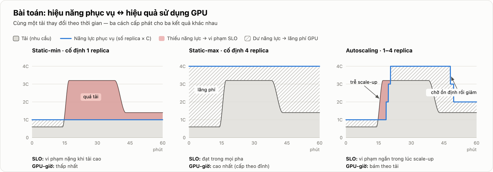

<!-- Mục đích: mục 1.1 của luận văn (Bối cảnh và bài toán), bản base lượt 1. Người viết: Trình. Viết ngày 27/11/2026 theo dàn ý ở docs/chi-tiet/06-ke-hoach-quan-ly.md §11.1 và nguồn ở docs/luan-van/nguon-tu-lieu.md §2 (dòng 1.1). Quy ước: docs/luan-van/README.md, docs/luan-van/quy-tac-viet.md -->
<!-- Thông điệp: (1) Doanh nghiệp tự host LLM trả tiền theo GPU, tải biến động mạnh, nên cấp phát tĩnh hoặc vi phạm SLO hoặc lãng phí GPU; autoscaling là hướng giải. (2) Với LLM trên GPU, autoscaling và các thao tác vận hành quen thuộc của web không áp nguyên được: cold start tính bằng phút, chỉ số GPU quen thuộc không phản ánh tải, request dài có trạng thái, rolling update kẹt khi hết GPU. (3) Bài toán là bài toán vận hành với ba yêu cầu kéo nhau: chất lượng phục vụ, hiệu quả GPU, vận hành được hằng ngày. -->
<!-- Soát số: chưa · Soát văn phong: kiem_van 27/11 · Người viết đọc lại: chưa -->
## 1.1. Bối cảnh và bài toán

Một doanh nghiệp muốn dùng mô hình ngôn ngữ lớn (*large language model*, LLM) cho công việc nội bộ có thể không được gửi dữ liệu ra API của nhà cung cấp bên ngoài. Khi đó doanh nghiệp phải tự chạy một model mã nguồn mở trên GPU (*graphics processing unit*) của mình hoặc GPU thuê, ví dụ cho một trợ lý nội bộ của vài nghìn nhân viên. Đội vận hành dịch vụ này nhận ba yêu cầu. Người dùng không phải chờ lâu kể cả lúc đầu giờ sáng, doanh nghiệp không trả tiền cho GPU chạy không ban đêm, và khi có sự cố thì người trực biết ngay và có sẵn hướng dẫn xử lý. Tình huống này gần với nơi làm việc của hai thành viên nhóm, một công ty cloud và một công ty an ninh mạng.

<!-- nguồn: docs/chi-tiet/01-bai-toan-yeu-cau.md §4 (đoạn "Bối cảnh": trợ lý AI nội bộ, dữ liệu không gửi ra API ngoài, ba yêu cầu của đội platform, nơi làm việc của hai thành viên) -->

GPU là chi phí chính và khó cấp phát. GPU được tính tiền theo giờ, kể cả những giờ không có request nào. Mỗi bản chạy của máy chủ model, gọi là một replica, chiếm trọn một GPU, nên năng lực phục vụ chỉ tăng hoặc giảm theo từng GPU. Trong khi đó, tải của một trợ lý nội bộ cao trong giờ làm việc, gần như bằng 0 ban đêm, và có những đợt tăng đột ngột.

<!-- nguồn: docs/chi-tiet/01-bai-toan-yeu-cau.md §4 (ba đặc điểm: đắt, rời rạc, tải không ổn định), §5.4 (tài nguyên rời rạc và đắt) -->

Hình 1.1 so sánh ba cách cấp phát cho cùng một tải như vậy. Cấp cố định ít replica thì khi tải tăng, request phải xếp hàng và độ trễ vượt mục tiêu mức dịch vụ (*service level objective*, SLO). Cấp cố định đủ cho mức tải đỉnh thì SLO luôn đạt, nhưng phần lớn thời gian GPU nhàn rỗi. Tự động điều chỉnh số replica theo tải (*autoscaling*) cho năng lực bám theo tải và tốn ít GPU-giờ hơn. GPU-giờ là số GPU bị giữ nhân với thời gian giữ, và là thước đo chi phí của đồ án (mục 1.2). Đổi lại, autoscaling có một khoảng trễ khi scale-up, gồm thời gian phát hiện tải tăng và thời gian khởi động replica mới, và trong khoảng đó hệ thống vẫn quá tải.

<!-- nguồn: docs/chi-tiet/01-bai-toan-yeu-cau.md §4 (Hình 1 và ba cách cấp phát; ví dụ tính tay 96 và 48 GPU-giờ/ngày không đưa vào vì chương 1 hạn chế số); §12.2 (G1: chi phí ≈ GPU-giờ) -->

Mức tiết kiệm này chỉ đạt được khi nền tảng vượt qua các khó khăn riêng của LLM trên GPU, vì cách làm quen thuộc với ứng dụng web không áp nguyên được. Một ứng dụng web khởi động trong vài giây. Một replica LLM phải tải image phần mềm nặng hàng GB, nạp trọng số của model vào bộ nhớ GPU rồi chuẩn bị GPU, nên cần hàng phút mới phục vụ được. Khoảng thời gian này gọi là cold start, và trong lúc chờ, tải tăng dồn hết lên các replica đang có. Chỉ số để quyết định scale cũng phải chọn lại. Chỉ số GPU utilization chỉ cho biết tỷ lệ thời gian GPU có việc, mà phần mềm phục vụ gộp nhiều request vào cùng một lượt tính nên GPU gần như luôn có việc ngay khi tải còn thấp. Scale theo chỉ số này, hệ thống sẽ thêm GPU khi chưa cần.

<!-- nguồn: docs/chi-tiet/01-bai-toan-yeu-cau.md §5.1 (bảng so với web service), §5.2 (cold start: pull image ~10 GB, nạp weights, compile, 1–8 phút), §5.3 (GPU utilization bão hoà vì continuous batching; VRAM cấp phát trước ~90%). Cơ chế chi tiết ở mục 2.1 và 2.3 -->

Các thao tác vận hành hằng ngày cũng có cạm bẫy riêng. Một request tới LLM kéo dài từ vài giây tới hàng chục giây, câu trả lời được gửi dần về từng phần (*streaming*), và trạng thái của request nằm trên đúng GPU đang xử lý nó. Khi bớt replica, replica phải được chờ xử lý xong các request đang chạy rồi mới tắt, nếu không request bị cắt giữa chừng. Cách cập nhật phiên bản thường dùng cho web tạo replica mới trước rồi mới xoá replica cũ. Khi mọi GPU đều đã có replica, replica mới không có GPU để chạy và lần cập nhật bị kẹt. Thêm nữa, bộ cân bằng tải mặc định chia request đều cho các replica mà không biết replica nào đang có hàng đợi dài.

<!-- nguồn: docs/chi-tiet/01-bai-toan-yeu-cau.md §5.5 (request dài, có trạng thái, phải drain), §5.6 (Service chia gần như ngẫu nhiên, không biết hàng đợi), §5.7 (maxSurge 1, maxUnavailable 0 kẹt khi hết GPU) -->

Từ bối cảnh trên, đồ án phát biểu bài toán như sau. Với một nhóm cố định N GPU (trong đồ án N = 4), xây dựng và vận hành một nền tảng phục vụ LLM tự host trên Kubernetes, nền tảng điều phối container mà đồ án dùng, sao cho đạt đồng thời ba yêu cầu:

- phần lớn request đạt SLO về độ trễ, kể cả khi tải thay đổi theo giờ hoặc tăng đột ngột (chất lượng phục vụ);
- số GPU-giờ bị giữ chỉ ở mức cần thiết, lúc tải thấp thì GPU được giải phóng (hiệu quả GPU);
- bớt replica và cập nhật phiên bản không làm rớt request, có cảnh báo kèm hướng dẫn xử lý khi chất lượng giảm, và toàn bộ nền tảng dựng lại được từ mã nguồn trong Git (vận hành được hằng ngày).

<!-- nguồn: docs/chi-tiet/01-bai-toan-yeu-cau.md §6 (phát biểu bài toán, N = 4, ba yêu cầu); docs/chi-tiet/00-thong-so.md §9.3 (N = 4) -->

Ba yêu cầu này kéo nhau. Chất lượng phục vụ muốn giữ nhiều GPU, còn hiệu quả muốn giữ ít. Giữ ít GPU thì phải scale thường xuyên, mà mỗi lần scale lại có rủi ro: thêm replica phải chờ cold start, bớt replica có thể cắt request. Đồ án vì vậy coi đây là một bài toán vận hành. Nhóm không tìm thuật toán autoscaling mới, mà ghép các thành phần mã nguồn mở phổ biến thành một nền tảng giữ được cả ba yêu cầu, rồi đo xem nó giữ được tới đâu. Nhờ đó, cấu hình và quy tắc cảnh báo rút ra từ đồ án dùng được cho các nền tảng phục vụ LLM khác dựa trên cùng cơ chế (mục 2.6).

<!-- nguồn: docs/chi-tiet/01-bai-toan-yeu-cau.md §6 (ba yêu cầu kéo nhau, Hình 1), §7 (ý nghĩa thực tiễn: thành phần chuẩn KEDA, HPA, Prometheus, Argo CD; áp dụng cho KServe, vLLM Production Stack), §11 (không đề xuất thuật toán mới) -->
