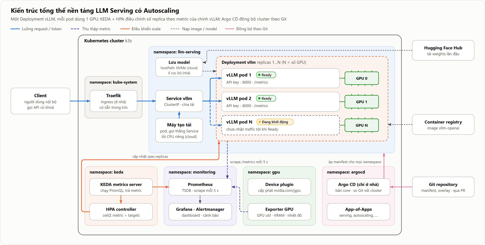

<!-- Mục đích: mục 3.2 của luận văn (Kiến trúc tổng thể), bản base lượt 1. Người viết: Trình. Quy ước: docs/luan-van/README.md, docs/luan-van/quy-tac-viet.md -->
<!-- Số đã đánh lại 25/11 khi ghép chương 3 (Hình 3.1, Bảng 3.1–3.8 theo thứ tự xuất hiện; Hình 3.2 thêm ở 3.5 ngày 28/11); chèn thêm hình hay bảng thì đánh lại cả chương. Hình 3.1 lấy từ Hình 2 của docs/chi-tiet/ (docs/images/png/02-kien-truc-tong-the.png) nhưng PHẢI VẼ LẠI trước khi chèn: hình còn ghi Traefik "giới hạn tốc độ, route riêng cho tải" (đã lược, ADR-006 §3.1), chưa có Argo CD và Git, chưa vẽ máy tạo tải gọi thẳng Service. Hình 6 (hai tầng) không chèn: còn ghi 4 × RTX A4000, A3/A4; Bảng 3.2 thay cho nó. -->
<!-- Ngân sách (D94): 2 trang, tính cả Hình 3.1 (khoảng 1/3 trang). Đo 24/11 (dàn thử, có chèn PNG hình 2 hiện tại): 1,65 tr (khuôn A), 1,98 tr (khuôn B); khoảng 510 chữ văn xuôi. Bảng 3.2 gọi "model 0,5B", "model 3B": tên đầy đủ Qwen2.5-0.5B-Instruct, Qwen2.5-3B-Instruct phải xuất hiện lần đầu ở chương 1 hoặc 2 (quy-tac-viet §4); máy V2 cụ thể (4 × RTX 4060 Ti 16 GB, Vast.ai) ghi ở 5.1. Ý không đưa vào, để chỗ khác: bảng namespace và danh sách thành phần đầy đủ (Kiến trúc §2, Phụ lục A); bảng thời gian từng bước của request (Kiến trúc §5, để 2.1); Ingress nào, vì sao không dùng ingress-nginx (Kiến trúc §3.5, để 4.1); tắt auto-sync và ignoreDifferences của root-app trong đợt đánh giá (Kiến trúc §18.2, để 4.1 hoặc 4.7); quy trình dựng lại từng lệnh và chỉ tiêu 30 phút (Vận hành §7, để 4.1 và 3.1); tiêu chí lọc máy thuê (Thông số §10.2, để 5.1). -->
<!-- Thông điệp: (1) Ba luồng: request (Service chia đều, không biết hàng đợi, giữ nguyên cho mọi cấu hình), autoscaling (Prometheus → KEDA → HPA → spec.replicas), thay đổi qua Git (Argo CD App-of-Apps ở nhà; Deployment không đặt replicas để không tranh với HPA). (2) Hai tầng, ba môi trường dùng chung base Kustomize, chỉ khác overlay; số hiệu năng chỉ lấy từ VM thuê; VM thuê không chạy Argo CD nên triển khai qua Git chỉ kiểm ở nhà; mọi phiên bản được ghim. (3) Bảo vệ tối thiểu chỉ còn mạng riêng và khoá API; ba lớp bị lược ghi vào 6.2. -->
<!-- Việc kéo theo: chương 2 (2.5) phải định nghĩa Kustomize base/overlay, App-of-Apps; 2.3 định nghĩa k3s, time-slicing; 2.4 định nghĩa external metric. Mục 6.2 nhận ba lớp bảo vệ bị lược. -->
<!-- 25/11 (PR chương 3, D102): gộp 3.2.3 Bảo vệ tối thiểu vào 3.2.1 thành đoạn mở bằng in đậm, theo Kế hoạch §11.1 (3.2.1 Thành phần và ba luồng); đoạn này đặt sau 3.2.2 trong bản 24/11 nên chuyển lên cuối 3.2.1. Giữ tên 3.2.2 "Hai tầng môi trường" (dàn ý ghi "Hai môi trường") vì có ba môi trường ở hai tầng -->
<!-- Soát số: 27/11/2026 · Soát văn phong: chưa · Người viết đọc lại: chưa -->
## 3.2. Kiến trúc tổng thể

Hệ thống gồm một Deployment vLLM trên Kubernetes, mỗi pod giữ một GPU (ở máy nhà là một GPU replica). Quanh nó là các thành phần để scale, quan sát và triển khai (Hình 3.1). Nhóm không thêm framework phục vụ nhiều tầng, để mỗi quyết định scale truy được về một truy vấn PromQL.
<!-- nguồn: docs/chi-tiet/03-kien-truc-autoscaling.md §1 (nguyên tắc "Đơn giản, minh bạch": Deployment và KEDA thay vì framework serving nhiều tầng; mọi quyết định scale truy được về một câu PromQL), §2 (bảng thành phần; 1 GPU/pod); docs/chi-tiet/00-thong-so.md §9.2 (nvidia.com/gpu: 1 mỗi pod) -->

<!-- Hình tạm: xem comment thứ hai ở đầu file; chú thích viết theo hình sẽ vẽ lại -->

Mục 3.2.1 đi qua các thành phần và ba luồng trên hình, mục 3.2.2 nói cách cùng các thành phần đó chạy ở ba môi trường.

### 3.2.1. Thành phần và ba luồng

**Luồng request.** Client gửi request tới API tương thích OpenAI, có streaming. Service chọn một pod đang Ready, vLLM kiểm API key rồi xử lý và trả từng phần câu trả lời. Service chia request gần như đều giữa các pod mà không biết pod nào đang có hàng đợi dài. Nhóm giữ cách chia này cho mọi cấu hình để so sánh công bằng, và mục 5.3 phân tích hệ quả của nó. Máy tạo tải gọi thẳng Service trong cluster, không qua Traefik Ingress.
<!-- nguồn: docs/chi-tiet/03-kien-truc-autoscaling.md §5 (các bước 1–5: POST /v1/chat/completions stream true, Service chọn pod Ready, vLLM kiểm khoá, waiting → running, prefill, decode, SSE), §3.4 (ClusterIP, kube-proxy chọn endpoint gần như ngẫu nhiên, đều nhau, không biết hàng đợi; giữ round-robin cho mọi cấu hình để so sánh công bằng; E1); docs/chi-tiet/00-thong-so.md §3 (F1), §7 (dòng "Đường đi": runner gọi thẳng Service vllm.llm-serving.svc:8000 ở nhà, simulator, VM thuê; khoá API vẫn được vLLM kiểm); envs/home/serving/ingress.yaml (Ingress chỉ có ở overlay nhà); .work/luan-van/bo-cuc.md mục A (TĐ2: Service chia đều trong khi hàng đợi dồn ở pod cũ) -->

**Luồng autoscaling.** Prometheus thu metric của vLLM và GPU mỗi 5 s. KEDA chạy truy vấn PromQL của tín hiệu scale (mục 3.3) và trả kết quả cho HPA, HPA ghi số replica mong muốn vào Deployment. Pod mới chỉ nhận request sau khi nạp xong model và qua readiness probe.
<!-- nguồn: docs/chi-tiet/00-thong-so.md §9.4 (scrape vLLM 5 s), §9.2 (readinessProbe /health); docs/chi-tiet/03-kien-truc-autoscaling.md §2 (chú thích Hình 2: KEDA chạy PromQL, cung cấp external metric cho HPA; HPA cập nhật spec.replicas; pod mới chỉ nhận traffic sau khi Ready), §17 (Prometheus, Grafana, Alertmanager) -->

**Luồng thay đổi qua Git.** Ở cluster nhà, Argo CD đồng bộ cluster theo Git bằng mô hình App-of-Apps [@argocd-cluster-bootstrapping]. Trên simulator, chỉ hai Application của phần phục vụ và autoscaling được áp thẳng, dùng cho phép thử cập nhật. Cập nhật hay rollback vì vậy là một commit hoặc một lệnh `git revert`. Deployment trong Git không đặt trường `replicas`, vì nếu có, Argo CD (khi bật self-heal) sẽ đưa số replica do HPA đặt về giá trị trong Git và hai bộ điều khiển tranh nhau.
<!-- nguồn: docs/chi-tiet/03-kien-truc-autoscaling.md §18.1 (App-of-Apps, root-app trỏ vào apps/), §18.3 (replicas trong Git + self-heal → Argo CD đặt lại, dao động; khuyến nghị bỏ trường replicas); envs/home/argocd/apps/ (8 Application: gpu-device-plugin, gpu-exporter, monitoring, monitoring-extras, keda, serving, autoscaling, observability); docs/chi-tiet/00-thong-so.md §3 (F3: rollback bằng git revert, không thao tác tay), §9.2 (replicas không đặt); common/serving/deployment.yaml (comment "Không đặt replicas"); Argo CD v3.5.4 docs/operator-manual/cluster-bootstrapping.md ("App Of Apps Pattern"). Tắt auto-sync của app autoscaling trong đợt đánh giá (Kiến trúc §18.2) để mục 4.7 -->

**Bảo vệ tối thiểu.** Hệ thống giữ ba lớp bảo vệ. API không có địa chỉ công khai, mọi request phải mang API key do vLLM kiểm, và mọi phiên bản được ghim (mục 3.2.2). Thiết kế ban đầu còn giới hạn tốc độ ở Traefik, một NetworkPolicy và bí mật mã hoá bằng Sealed Secrets. Nhóm lược ba lớp này vì chúng chạy ngầm, không thể hiện trong kết quả đánh giá (mục 6.2).
<!-- nguồn: docs/chi-tiet/04-van-hanh.md §8 (chỉ làm lớp Mạng, Xác thực, Chuỗi cung ứng; lược Giới hạn tốc độ, Cô lập trong cluster, Bí mật; VM thuê chỉ SSH mở ra ngoài; máy nhà chỉ LAN và Tailscale; --api-key của vLLM; NetworkPolicy chỉ cho Traefik và Prometheus; Sealed Secrets cho khoá API, token HF, token Telegram); docs/chi-tiet/00-thong-so.md §3 (F7, Should; sửa 12/11); docs/adr/006-chot-may-model-va-kich-ban-truoc-v2.md §3.1 (lược vì hội đồng không nhìn thấy; Secret tạo tay từ .env đã gitignore; VH4 dùng NetworkPolicy tạm làm ví dụ). Lớp chuỗi cung ứng (ghim phiên bản) đã nói ở đoạn trước. "chạy ngầm, không thể hiện trong kết quả đánh giá": theo cột Lý do của ADR-006 §3.1 (Sealed Secrets "chạy ngầm, không có gì để trình diễn"; tiêu chí: hội đồng không nhìn thấy thì lược) -->

### 3.2.2. Hai tầng môi trường dùng chung manifest

GPU thuê tính tiền theo giờ, nên môi trường chia hai tầng (Bảng 3.2). Tầng 2 trên VM thuê dùng để đo và để lặp lại những kịch bản vận hành cần GPU thật, còn tầng 1 gồm simulator và máy nhà dùng để phát triển và vận hành thử. Manifest chung nằm ở một base Kustomize, mỗi môi trường chỉ có một overlay ghi đè giá trị riêng như model và threshold. Nhờ vậy cả ba nơi dùng cùng một Deployment, Service và ScaledObject gốc, và lỗi ở phần dùng chung tìm thấy trên simulator cũng có trong cấu hình được đo. Số liệu hiệu năng ở chương 5 chỉ lấy từ VM thuê.
<!-- nguồn: docs/chi-tiet/05-moi-truong-danh-gia.md §1 (hai tầng cùng một bộ manifest, chỉ khác overlay; chi phí ≈ 0 ở nhà, theo giờ ở cloud; số liệu nhà chỉ dùng đạt/không đạt), §2.7 (llm-d-inference-sim giả lập API và metric của vLLM; T1–T7, scale 1 → 3); docs/chi-tiet/03-kien-truc-autoscaling.md §4 (common/serving base; envs/home, envs/cloud, envs/sim overlay; overlay sim dùng đúng Deployment, Service, ScaledObject; home và cloud chỉ khác giá trị ở Thông số §9.1–§9.2); docs/chi-tiet/00-thong-so.md §10.1 ("môi trường chức năng: không dùng số liệu hiệu năng của nó") -->

**Bảng 3.2.** Hai tầng môi trường, triển khai từ cùng một Git repository

| Môi trường | Simulator (tầng 1) | Máy nhà (tầng 1) | VM thuê (tầng 2) |
|---|---|---|---|
| Hạ tầng | kind, không GPU | k3s, RTX 5060 8 GB | k3s, 4 GPU 16 GB |
| Phục vụ | llm-d-inference-sim | vLLM, model 0,5B | vLLM, model 3B |
| Dùng cho | Kiểm thử autoscaling, vận hành không cần GPU | Chức năng, vận hành | Đánh giá, vận hành |
<!-- nguồn: docs/chi-tiet/00-thong-so.md §10.1 (PC RTX 5060 8 GB, time-slicing 2 GPU replica từ 06/11), §10.2 (Vast.ai chế độ VM, 4 GPU 16 GB; máy V2 thực tế là 4 × RTX 4060 Ti, ghi ở 5.1 theo nguon-tu-lieu.md dòng 170), §9.3 và mục 3.3 (max: nhà 2, simulator 3, cloud 4); envs/home/serving/patch-vllm.yaml (Qwen/Qwen2.5-0.5B-Instruct); docs/phien-ban.md (model cloud Qwen2.5-3B-Instruct); Makefile (sim-up, home-up, bootstrap, cloud-platform); docs/chi-tiet/05-moi-truong-danh-gia.md §1 (mục đích từng tầng), §2.7 -->

VM thuê không chạy Argo CD, vì VM bị huỷ sau mỗi phiên đo và Argo CD là thêm một thành phần phải gỡ lỗi trên máy tính tiền theo giờ. Ansible dựng k3s, rồi Helm và Kustomize cài phần nền thẳng từ Git. Đổi lại, triển khai qua Git chỉ được kiểm ở cluster nhà, còn vòng cập nhật rồi rollback qua Git mới chạy trên simulator, chưa chạy trên GPU thật. Mọi phiên bản, từ image, model tới chart Helm, đều được ghim (Phụ lục D), nên cấu hình được đo có thể dựng lại đúng như cũ.
<!-- nguồn (Argo CD trên simulator): docs/adr/007-doi-vh1-vh2-f6-n8-khoi-cluster-nha.md D2 (vòng Git của VH2 chạy trên kind + simulator có Argo CD, Application theo dõi nhánh thử; chưa có lần nào đi trọn vòng Git trên GPU thật); envs/sim/argocd/apps.yaml (hai Application serving, autoscaling, áp thẳng, không có root App-of-Apps); 05-05 §5.5.1 (bốn commit, 615 request, 0 lỗi) -->
<!-- nguồn: docs/adr/006-chot-may-model-va-kich-ban-truoc-v2.md §3.1 (lược Argo CD trên VM thuê: VM bị huỷ sau V2; F4 vẫn đạt bằng make bootstrap + make cloud-platform), §3 (cloud cài nền bằng helm qua make cloud-platform, argocd_enabled: false; VH2 trên VM kích hoạt rollout bằng annotation, không qua Git); docs/chi-tiet/04-van-hanh.md §7 ("để bớt một thành phần phải gỡ lỗi trên máy tính tiền theo giờ; GitOps đầy đủ được kiểm chứng trên cluster nhà"; make cloud-platform: helm cho device plugin, kube-prometheus-stack, KEDA, exporter GPU; kustomize cho vLLM); docs/phien-ban.md (vLLM theo digest, model theo revision, chart theo phiên bản); docs/chi-tiet/00-thong-so.md §4 (N8: mọi phiên bản được ghim) -->
