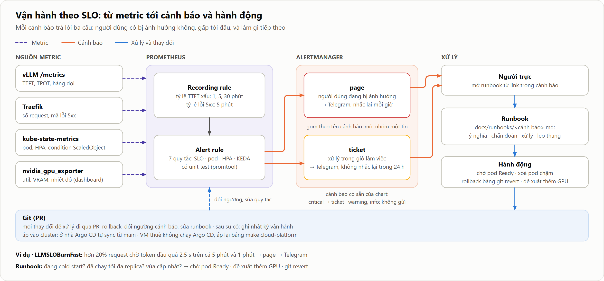

<!-- Mục đích: mục 3.5 của luận văn (Thiết kế giám sát, cảnh báo và xử lý sự cố), mẫu văn cho các mục khác. Người viết: Trình. Quy ước: docs/luan-van/README.md, docs/luan-van/quy-tac-viet.md -->
<!-- Số đã đánh lại 25/11 khi ghép chương 3 (Hình 3.1, Bảng 3.1–3.8 theo thứ tự xuất hiện; Hình 3.2 thêm ở 3.5 ngày 28/11); chèn thêm hình hay bảng thì đánh lại cả chương. Hình 7 của docs/chi-tiet/ (vòng vận hành, PR #60) chèn 28/11 thành Hình 3.2 ở 3.5.2. -->
<!-- Khôi phục 25/11 (D118, D119) từ bản base d14e6e5: burn rate 14,4 của SRE Workbook, mốc 20% trùng page giả nhưng khác nguồn, định nghĩa page và ticket, cột lý do của Bảng 3.7, định tuyến của Alertmanager, khung runbook, chỉ sửa qua Git. Ngân sách cũ (Kế hoạch §11.1, quy-tac-viet.md §1): 2 trang. Cắt 24/11 từ 4–5 trang: Bảng SLI thành văn xuôi (bảng đầy đủ ở docs/chi-tiet/04-van-hanh.md §2.1, 00-thong-so.md §6); bảng cảnh báo bỏ cột lý do (còn hai câu; lý do từng quy tắc ở 04-van-hanh.md §3.2 và comment trong common/observability/alerts/llm.yaml); tên ba dashboard (common/observability/dashboards/README.md, 00-thong-so.md §3 F5; để mục 4.6); công thức thời gian báo đưa vào câu; gộp 3.5.3 và 3.5.4; bỏ thời điểm tắt cảnh báo và tin "đã hết" (để chương 5, LT8; công thức ở nhật ký Trình tuần 07, mục 16/11); bỏ chi tiết runbook mẫu (Phụ lục C; 04-van-hanh.md §4); định nghĩa page và ticket chuyển vào chú thích Bảng 3.7; hai điểm yếu đã biết, page vì một đợt lỗi 503 ngắn và Watchdog chưa nối ra ngoài (để mục 6.2; 04-van-hanh.md §3.5; nhật ký Trình tuần 07, mục 18/11); bỏ việc chart có 134 cảnh báo, 100 ở mức warning/info không gửi đi (để mục 4.6; comment trong common/platform/alertmanager-values.yaml); bỏ ý mất metric nguồn thành 0 (có ở mục 3.3, PR #66; Kiến trúc §13.4); bỏ biên TPOT 0,1 s và cửa sổ recording rule (04-van-hanh.md §2.1). -->
<!-- Thông điệp: (1) SLI tính ở phía server, cảnh báo và dashboard đọc chung một bộ recording rule; nghiệm thu dùng log của máy tạo tải vì SLI phía server có điểm mù. (2) Page theo burn rate trên hai cửa sổ 5 phút và 1 phút (mốc 20% request xấu): vi phạm rõ thì có tin sau khoảng 2,5–3,5 phút; cửa sổ ngắn nhạy hơn với đợt xấu ngắn nên số page giả phải đo. (3) Hệ thống tự xử lý việc lặp lại; người trực chỉ được gọi khi có việc phải làm, có runbook cho từng cảnh báo, và sửa cấu hình qua Git. -->
<!-- Soát số: 27/11/2026 · Soát văn phong: chưa · Người viết đọc lại: chưa -->
## 3.5. Thiết kế giám sát, cảnh báo và xử lý sự cố

Giám sát phải cho người vận hành biết ba điều: dịch vụ có đạt SLO ở mục 3.1 không, khi nào cần vào cuộc, và vào cuộc thì làm gì. Nhóm dùng chart kube-prometheus-stack [@kube-prometheus-stack] cho Prometheus, Alertmanager và Grafana. Nguyên tắc chung là hệ thống tự xử lý việc lặp lại, chỉ gọi người khi cần người làm.
<!-- nguồn: docs/chi-tiet/04-van-hanh.md §1 (bảng "Vận hành gồm những việc gì": quan sát, cảnh báo, xử lý); common/platform/kube-prometheus-stack-values.yaml (chart 92.1.1); common/platform/alertmanager-values.yaml (receiver Telegram) -->

### 3.5.1. SLI và cảnh báo theo burn rate

TTFT là SLI chính, vì vLLM tính TTFT gồm cả thời gian chờ trong hàng đợi nên TTFT tăng đầu tiên khi hệ thống quá tải. Tỷ lệ lỗi đo ở Traefik, cửa vào của cluster, vì khi không còn pod Ready thì chỉ Traefik thấy request. TPOT ít biến động hơn nên không có cảnh báo riêng, chỉ được vẽ trên dashboard và xét khi nghiệm thu. Ngưỡng 2,5 s được chọn trùng một biên bucket có thật của histogram TTFT trong bản vLLM đã ghim [@vllm-metrics], vì với biên không có, truy vấn trả về rỗng và cảnh báo im lặng. Cảnh báo và dashboard đọc chung các recording rule tính sẵn tỷ lệ TTFT xấu và tỷ lệ lỗi, nên người trực thấy đúng con số mà cảnh báo dùng. Ba dashboard (mục 4.6) lần lượt cho thấy trạng thái pod và GPU, số replica so với tải, ngân sách lỗi và GPU-giờ của từng lượt đánh giá.
<!-- nguồn: docs/chi-tiet/04-van-hanh.md §2.1 (bảng "Chọn SLI": vì sao chọn TTFT, tỷ lệ lỗi đo ở Traefik, TPOT chỉ theo dõi; điểm lưu ý thứ nhất: ngưỡng trùng biên bucket); common/observability/dashboards/README.md (vLLM thật tính TTFT gồm thời gian chờ); common/observability/rules/slo.yaml (comment Traefik thấy 502/503; le="2.5"); docs/adr/005-sua-thiet-ke-sau-review.md T3; docs/chi-tiet/00-thong-so.md §6 (đã kiểm 23/10: v0.31.0 có le="2.5" trên /metrics); common/observability/rules/slo.yaml (llm:ttft_bad_ratio:rate1m/5m/30m, llm:error_ratio:rate5m); common/observability/dashboards/slo-cost.json (panel "Burn rate TTFT" và tỷ lệ SLI đọc llm:*); docs/chi-tiet/00-thong-so.md §3 (F5: 3 dashboard); common/observability/dashboards/README.md; tiêu đề panel trong serving-gpu.json ("Request đang chờ", "KV-cache đang dùng", "GPU (nvidia_gpu_exporter, mỗi đường một GPU)"), autoscaling.json ("Số replica: HPA muốn và thực tế"), slo-cost.json ("Burn rate TTFT", "Ngân sách lỗi TTFT còn lại", "GPU-giờ") -->

Nghiệm thu dùng log của máy tạo tải, vì SLI phía server có ba điểm mù. Histogram TTFT bỏ sót request hết thời gian chờ khi còn trong hàng đợi, còn request bị cắt giữa stream vẫn mang mã 200. Trong các lượt đánh giá, máy tạo tải gọi thẳng Service của vLLM nên Traefik không thấy lỗi.
<!-- nguồn: docs/chi-tiet/00-thong-so.md §6 (TTFT ≤ 2,5 s, TPOT ≤ 100 ms, request đạt SLO gồm TTFT, TPOT, không lỗi, không timeout, stream không bị cắt), §4 (N7 đối chiếu với log client); docs/chi-tiet/04-van-hanh.md §2.1 (điểm lưu ý thứ hai, thứ ba); envs/cloud/experiments/matrix-v2.yaml (target.service_url http://vllm.llm-serving.svc:8000); docs/nhat-ky/lam-viec/trinh/tuan-07.md mục 16/11 TR7 (llm:error_ratio:rate5m rỗng khi gọi thẳng Service) -->

Page về chất lượng phục vụ dựa trên burn rate trên hai cửa sổ (mục 2.5), không dựa trên ngưỡng p95 của TTFT. Với SLO 99,9%, SRE Workbook [@sre-workbook] đề xuất page ở burn rate 14,4 trên cả cửa sổ 1 giờ và 5 phút. Nhóm giữ cách xét hai cửa sổ nhưng rút còn 5 phút và 1 phút, vì mỗi lượt đánh giá chỉ dài 12–24 phút. `LLMSLOBurnFast` kêu khi burn rate vượt 4 trên cả hai cửa sổ trong 1 phút liên tục, nghĩa là hơn 20% request có TTFT vượt 2,5 s với SLO 95%. Ở ngưỡng này, cửa sổ 1 giờ cần ít nhất 12 phút mới vượt kể cả khi mọi request đều xấu, quá giới hạn 5 phút ở mục 3.1. Mốc 20% cũng là mốc định nghĩa page giả ở mục 3.6, nhưng hai bên đo khác nguồn: cảnh báo chỉ xét TTFT phía server, còn page giả tính theo log của máy tạo tải, gồm cả TPOT, lỗi và stream bị cắt.
<!-- nguồn: docs/chi-tiet/02-kien-thuc-nen.md §5.2; docs/chi-tiet/04-van-hanh.md §2.2 (lượt dài 12–24 phút, cửa sổ rút ngắn), §3.3 (14,4; 1 giờ và 5 phút; burn rate 4 = 20% request xấu); common/observability/alerts/llm.yaml (LLMSLOBurnFast: rate5m > 4 * 0.05 and rate1m > 4 * 0.05, for 1m, severity page); docs/chi-tiet/00-thong-so.md §6 (SLO 95%, request đạt SLO gồm TTFT, TPOT, không lỗi, stream không bị cắt), §4 (N7: ≤ 5 phút; page giả = page khi tỷ lệ request xấu theo log client < 20%); common/observability/rules/slo.yaml (ttft_bad_ratio chỉ từ histogram TTFT); bản base commit d14e6e5 (mục 3.5.2: 14,4, mốc 20% trùng page giả). 12 phút = 3600 · 0,2 / 1 giây, khi mọi request đều xấu; tính từ công thức, không phải số đo -->

Giả sử tốc độ request không đổi và tỷ lệ request xấu nhảy từ 0 lên $x$ sau 5 phút traffic tốt. Cửa sổ 5 phút vượt ngưỡng $\theta = 0{,}2$ sau $300\theta/x$ s, rồi còn 60 s của `for` và 30 s Alertmanager chờ gom nhóm. Với $x$ từ 50% tới 100%, tin nhắn tới sau khoảng 2,5–3,5 phút (ước tính), cộng tối đa 20 s trễ scrape và tính rule. Với $x$ chỉ nhỉnh hơn 20%, thời gian này có thể quá 5 phút. Cặp cửa sổ ngắn nhạy hơn với đợt xấu ngắn, nên số page giả phải được đo (mục 3.6).
<!-- nguồn: docs/nhat-ky/lam-viec/trinh/tuan-07.md mục 16/11 "công cụ đo LT8" (dự đoán θ·300/x + 60 s); common/observability/alerts/llm.yaml (for 1m; comment vai trò hai cửa sổ); common/platform/alertmanager-values.yaml (group_wait 30s); docs/chi-tiet/04-van-hanh.md §3.3 (ước tính 3–4 phút); common/serving/podmonitor.yaml (scrape 5s); common/platform/kube-prometheus-stack-values.yaml (evaluationInterval 15s); docs/nhat-ky/van-hanh.md mục LT8 "Hệ quả cho V2 (VH6)" (x gần 0,2 thì có thể vượt 5 phút); docs/chi-tiet/00-thong-so.md §4 (N7: page giả = page khi tỷ lệ request xấu theo log client < 20%); 2,5–3,5 phút tính từ công thức (x = 1: 150 s; x = 0,5: 210 s); không phải số đo -->

### 3.5.2. Định tuyến cảnh báo, runbook và người trực

Mỗi cảnh báo phải dẫn tới một việc người trực cần làm, nếu không thì sửa hoặc bỏ. Page dành cho lúc người dùng đang bị ảnh hưởng và cần người trực ngay. Ticket dành cho sự cố chờ được tới giờ làm việc. Bảy quy tắc ở Bảng 3.7 ứng với sáu cảnh báo bắt buộc ở mục 3.1, vì trường hợp pod không khởi động được tách thành hai quy tắc. Mỗi quy tắc có runbook và unit test trong CI.
<!-- nguồn: docs/chi-tiet/04-van-hanh.md §3.1 (nguyên tắc 1–5: triệu chứng trước, nguyên nhân sau), §3.2 (6 cảnh báo = 7 quy tắc: pod không khởi động được = LLMPodNotReady + LLMPodCrashLooping; 7 runbook); common/observability/alerts/llm.yaml (comment LLMAtMaxReplicas: chỉ bằng max thì chưa phải vấn đề); CONTRIBUTING.md §4 (promtool test rules trong CI); common/observability/alerts/tests/llm-test.yaml; docs/runbooks/ (7 file); common/platform/alertmanager-values.yaml (route: Watchdog và gốc "null"; page repeat_interval 1h, send_resolved true; ticket|critical repeat_interval 24h, send_resolved false, comment "24 h dài hơn cả một phiên V2"); docs/chi-tiet/04-van-hanh.md §3.4 -->

**Bảng 3.7.** Bảy quy tắc cảnh báo

| Cảnh báo | Điều kiện (rút gọn) | `for` | Mức | Lý do của điều kiện |
|---|---|---|---|---|
| `LLMSLOBurnFast` | > 20% request có TTFT > 2,5 s | 1 phút | page | Người dùng phải chờ lâu |
| `LLMErrorRateHigh` | Tỷ lệ 5xx ≥ 1% trong 5 phút | 1 phút | page | Request bị từ chối; lỗi có mục tiêu riêng là 99% request không trả 5xx, nên ngân sách lỗi là 1% |
| `LLMAtMaxReplicas` | Replica tối đa **và** hàng đợi > 0 | 15 phút | ticket | Autoscaling hết dư địa; chạy tối đa mà vẫn kịp tải thì chưa phải vấn đề |
| `LLMPodPending` | Pod vLLM Pending | 10 phút | ticket | Thường do hết GPU |
| `LLMPodNotReady` | Pod vLLM Running nhưng chưa Ready | 15 phút | page | Lâu hơn cold start tối đa |
| `LLMPodCrashLooping` | Có `CrashLoopBackOff` trong 5 phút | 5 phút | page | OOM, sai tham số, lỗi CUDA |
| `KedaScalerErrors` | Đang fallback hoặc không Ready | 1 phút | page | Autoscaling mất tín hiệu, giữ số replica cố định |
<!-- nguồn: common/observability/alerts/llm.yaml (7 rule: expr, for, severity; điều kiện rút gọn: LLMSLOBurnFast xét cả hai cửa sổ như đoạn trên, KedaScalerErrors bỏ qua ScaledObject đang Paused); docs/chi-tiet/04-van-hanh.md §3.2; docs/chi-tiet/00-thong-so.md §6 (SLO tỷ lệ lỗi 99%, ngân sách 1%); quy-tac-viet.md §4 (page, ticket) -->

Hai quy tắc đầu là triệu chứng người dùng thấy, năm quy tắc sau chỉ ra nguyên nhân. Alertmanager [@alertmanager-config] định tuyến theo nhãn mức độ. Page tới Telegram, nhắc lại mỗi giờ nếu chưa hết và báo cả lúc đã hết. Ticket và cảnh báo critical có sẵn của chart không nhắc lại trong 24 giờ, dài hơn một phiên đo, và không báo lúc đã hết. Các mức warning và info của chart không được gửi đi, vì nhiều cảnh báo ở hai mức này trùng ý với cảnh báo của nhóm và kêu liên tục, như `KubeHpaMaxedOut` so với `LLMAtMaxReplicas`. Cảnh báo cùng tên gom thành một tin, kèm nhãn môi trường và link runbook.
<!-- nguồn: docs/chi-tiet/04-van-hanh.md §3.1 (triệu chứng trước, nguyên nhân sau), §3.4; common/observability/alerts/llm.yaml (comment LLMAtMaxReplicas: chỉ bằng max thì chưa phải vấn đề); common/platform/alertmanager-values.yaml (page repeat_interval 1h, send_resolved true; ticket|critical repeat_interval 24h, send_resolved false, comment "24 h dài hơn cả một phiên V2") -->

<!-- nguồn: docs/images/png/07-slo-canh-bao-runbook.png (Hình 7 của docs/chi-tiet/04-van-hanh.md §1, vẽ lại ở PR #60 từ docs/diagrams/); common/observability/alerts/llm.yaml (7 quy tắc); common/platform/alertmanager-values.yaml (page nhắc lại 1h, ticket 24h, warning và info không gửi) -->

Hình 3.2 ghép các phần trên thành một đường đi: metric sinh cảnh báo, Alertmanager định tuyến theo mức độ, người trực xử lý theo runbook.

Hệ thống tự xử lý các sự cố lặp lại, còn người trực quyết định những việc cần phán đoán. Kubelet khởi động lại container vLLM bị chết, ReplicaSet thay pod bị xoá, còn KEDA giữ số replica ở mức tối đa khi không truy vấn được Prometheus [@keda-scaledobject-spec] (mục 3.3). Người trực vào cuộc khi có page và quyết định các việc như rollback một bản cập nhật, chuyển pod khỏi một GPU lỗi hay đề xuất thêm GPU.
<!-- nguồn: docs/chi-tiet/04-van-hanh.md §6 (bảng "Sự cố và tự phục hồi"), §1 (chú thích Hình 7: mọi thay đổi để xử lý đều đi qua Git), §5.4 (rollback bằng git revert); common/autoscaling/a2/scaledobject-a2.yaml (fallback failureThreshold 3, replicas 4 = max); docs/runbooks/LLMSLOBurnFast.md, LLMAtMaxReplicas.md (đề xuất thêm GPU); docs/chi-tiet/00-thong-so.md §3 (F3: không thao tác tay trên cluster) -->

Mỗi runbook (Phụ lục C) theo một khung chung: cảnh báo nghĩa là gì, người dùng đang thấy gì, cần xem gì trong 5 phút đầu, xử lý từng nguyên nhân ra sao, khi nào gọi thêm người và ghi lại gì sau sự cố. Mọi thay đổi cấu hình để xử lý sự cố đều đi qua Git, kể cả rollback bằng `git revert`, nên lần sửa nào cũng có lịch sử và đảo ngược được. Thao tác trực tiếp trên cluster chỉ dùng để chẩn đoán, hoặc cho việc không đổi cấu hình như xoá một pod chậm bất thường. Sau sự cố, người trực ghi vào nhật ký vận hành và bổ sung runbook nếu thiếu bước.
<!-- nguồn: docs/chi-tiet/04-van-hanh.md §4.1 (mẫu runbook: Ý nghĩa, Ảnh hưởng, Chẩn đoán nhanh ≤ 5 phút, Xử lý, Leo thang, Sau sự cố), §1 (chú thích Hình 7: mọi thay đổi để xử lý đều đi qua Git), §5.4 (rollback bằng git revert); docs/chi-tiet/00-thong-so.md §3 (F3: không thao tác tay trên cluster); docs/runbooks/ (7 file); docs/runbooks/LLMSLOBurnFast.md (xoá pod chậm; mục "Sau sự cố"); bản base commit d14e6e5 (mục 3.5.4). Ví dụ runbook LLMSLOBurnFast để Phụ lục C -->
