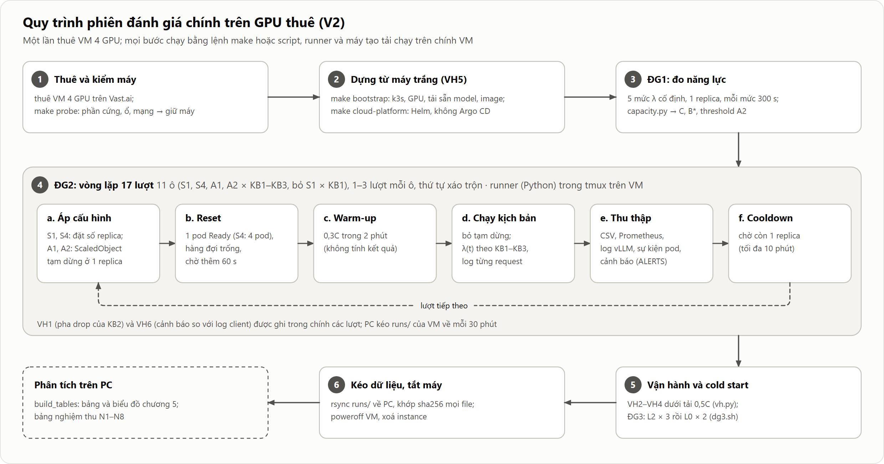

<!-- Khôi phục 25/11 (D118, D119) từ bản base 6e63ad5: hai câu hỏi của đánh giá, lý do số đo hiệu năng chỉ lấy từ VM thuê, lý do không dùng closed-loop, prompt 256–1024 token, lý do đỉnh 0,75 × N × C và thời lượng từng pha, hai lượt chỉ khác cấu hình, cách báo chỉ số đề cương, GPU-giờ không thổi phồng, lý do chấm cảnh báo độc lập, lý do LT chạy ở máy nhà. -->
<!-- Mục đích: mục 3.6 của luận văn (Thiết kế đánh giá): ba lớp đánh giá, kịch bản tải KB1–KB3, ĐG1–ĐG3 và chỉ số theo đề cương, quy tắc so sánh, điều kiện hợp lệ của lượt đo, VH1–VH6, LT1–LT8, cách chấm cảnh báo và page giả. Người viết: Trình. Quy ước: docs/luan-van/README.md, docs/luan-van/quy-tac-viet.md. Cuối file có mục "Kết chương" của chương 3 (như chương 5). Ngân sách 2 trang (D94); cắt ngày 24/11, các ý đã cắt và nơi chứa chúng ghi ở docs/luan-van/nguon-tu-lieu.md dòng 3.6 -->
<!-- Số đã đánh lại 25/11 khi ghép chương 3 (Hình 3.1, Bảng 3.1–3.8 theo thứ tự xuất hiện); chèn thêm hình hay bảng thì đánh lại cả chương. Hình 8 và Hình 17 của docs/chi-tiet/ (vẽ lại ở PR #90) chèn 28/11 thành Hình 3.3 và Hình 3.4; Hình 3.3 giữ mã N1–N7 và tên pha tiếng Anh của mã phân tích, chú thích giải nghĩa tên pha. -->
<!-- Thông điệp: (1) Mỗi chỉ tiêu có một phép thử định trước, thuộc một trong ba lớp (kiểm thử chức năng, kịch bản vận hành, phép đo trên VM thuê); mọi mức tải tính theo năng lực C của một replica. (2) Hai cấu hình chỉ được coi là khác nhau khi mọi lượt cùng chiều và vượt ngưỡng thực tiễn; một lượt chỉ được tính khi máy tạo tải và đường thu số liệu không là nút thắt. (3) Cảnh báo được chấm bằng log của máy tạo tải, độc lập với chính cảnh báo; kiểm chứng lý thuyết đặt dự đoán trước khi đo, ca nào không làm được thì ghi rõ. -->
<!-- Soát số: 27/11/2026 · Soát văn phong: chưa · Người viết đọc lại: chưa -->
## 3.6. Thiết kế đánh giá

Đánh giá trả lời hai câu hỏi: nền tảng có đạt các chỉ tiêu ở mục 3.1 không, và để đạt thì phải đánh đổi những gì. Mỗi chỉ tiêu có một phép thử định trước, thuộc một trong ba lớp kiểm thử chức năng, kịch bản vận hành và phép đo hiệu năng. Phép đo nào không phục vụ chỉ tiêu nào thì nhóm không làm. Kiểm thử chức năng chạy trên simulator và máy nhà. Kịch bản vận hành chạy trên VM thuê với phần cần GPU và trên simulator với phần không cần GPU, riêng graceful shutdown được đo ở máy nhà. Phép đo hiệu năng chạy trên một VM thuê có N = 4 GPU cùng loại. Máy nhà chia một GPU thành hai GPU replica bằng time-slicing, nên hai pod dùng chung nhân GPU và số đo của từng pod không độc lập.
<!-- nguồn: docs/chi-tiet/05-moi-truong-danh-gia.md §7 (bảng ba lớp: kiểm thử chức năng chạy lại trong CI nếu tự động hoá được; VH ở nhà và simulator trước, lặp lại trên GPU thuê phần cần GPU thật; ĐG1–ĐG3 trên GPU thuê), §18 (GPU nhà 8 GB, time-slicing, số đo từng pod không độc lập); docs/chi-tiet/01-bai-toan-yeu-cau.md §12.5 (một lần thuê liền; không dùng số liệu máy nhà để kết luận); docs/chi-tiet/00-thong-so.md §2, §10.2 (N = 4 GPU cùng loại); bản base commit 6e63ad5 (đoạn mở: hai câu hỏi, mỗi phép đo gắn một chỉ tiêu; mục 3.6.1: time-slicing, số đo từng pod không độc lập) -->

### 3.6.1. Tải và kịch bản tải

Máy tạo tải gửi request theo kiểu open-loop (mục 2.2). Thời điểm gửi được sinh trước theo quá trình Poisson với tốc độ λ(t), không phụ thuộc phản hồi của nền tảng. Nhóm không dùng kiểu closed-loop, vì khi nền tảng chậm, máy tạo tải kiểu này gửi chậm theo và quá tải bị che mất trong số đo. Lịch gửi và độ dài prompt sinh từ một seed theo kịch bản và lần lặp, nhờ đó mọi cấu hình nhận cùng một chuỗi request. Prompt là văn bản tổng hợp dài 256–1.024 token, phân phối đều. Output cố định 256 token để mọi request có cùng lượng việc decode.
<!-- nguồn: docs/chi-tiet/05-moi-truong-danh-gia.md §9 (closed-loop che mất quá tải; thời điểm gửi sinh trước theo λ(t), Poisson, độc lập với phản hồi; mọi cấu hình nhận cùng chuỗi request), §18 (output cố định để lượng việc như nhau); docs/chi-tiet/00-thong-so.md §7 (seed theo kịch bản và lượt; prompt tổng hợp 256–1024 token, phân phối đều; max_tokens=256, ignore_eos=true; stream=true; timeout 120 s tính là lỗi, đã nêu ở 3.1) -->

Ba kịch bản tải theo đề cương tái hiện ban đêm, đầu giờ sáng và giờ cao điểm (Bảng 3.8, Hình 3.3). Đỉnh của KB2 và KB3 là 3,0 C, bằng 0,75 × N × C với N = 4. Với threshold ở mục 3.3, mức này cần vừa đủ 4 replica. Ở 3,5 C sẽ cần 5 replica, vượt số GPU, và kết quả khi đó nói về việc thiếu GPU chứ không về autoscaling. KB2 giảm tải trở lại ở phút 14 để một lượt kiểm được cả scale-up lẫn scale-down.
<!-- nguồn: docs/chi-tiet/05-moi-truong-danh-gia.md §10 (ba kịch bản của đề cương; KB2 giảm tải trở lại để một lượt kiểm cả scale-up lẫn scale-down; "Vì sao KB3 dừng ở 0,75 × N × C": target 0,8 × B\*, 3,5C cần ⌈3,5 ÷ 0,8⌉ = 5 replica, vượt 4 GPU; ở 3C cần đúng 4); docs/chi-tiet/00-thong-so.md §7 (đỉnh KB2 0,75 × N) -->

Thời lượng các pha tính từ thời gian chờ của chính nền tảng. Pha ổn định và pha duy trì dài ít nhất 10 phút, bằng hai cửa sổ chờ scale-down 300 s, để thấy được flapping. Pha tăng đột ngột giữ 10 phút vì một lần đo thử cold start L2 trên máy khác, trước phiên đo chính, đã mất hơn 6 phút, dài hơn nhiều so với mức 0,5–1,5 phút dự kiến khi đặt ngưỡng 2 phút cho thời gian phản ứng (mục 3.1). Với cold start như vậy, replica mới chỉ Ready sau nửa đầu của pha. Pha giảm cũng giữ 10 phút để pod cuối cùng kịp bị xoá, theo ước tính khoảng 8 phút sau khi tải giảm.
<!-- nguồn: docs/chi-tiet/05-moi-truong-danh-gia.md §10 (ba kịch bản của đề cương; KB2 giảm tải trở lại để một lượt kiểm cả scale-up lẫn scale-down; "Vì sao KB3 dừng ở 0,75 × N × C": target 0,8 × B\*, 3,5C cần ⌈3,5 ÷ 0,8⌉ = 5 replica, vượt 4 GPU; ở 3C cần đúng 4); docs/chi-tiet/00-thong-so.md §7 (đơn vị C đo ở ĐG1; "Giới hạn khi rút": steady, sustain ≥ 10 phút = hai cửa sổ scale-down 300 s; spike giữ 10 phút vì cold start vLLM 3B đo 08/11 là 363–377 s; drop 10 phút, với N = 4 pod cuối bị xoá khoảng 8 phút sau khi tải giảm; replica mới chỉ Ready ở khoảng phút 6,5 của pha spike); docs/chi-tiet/01-bai-toan-yeu-cau.md §12.5 (máy khác thì đo lại ĐG1); bản base commit 6e63ad5 (mục 3.6.2). Đoạn thứ hai (thời lượng pha) khôi phục 25/11 (D119) -->

**Bảng 3.8.** Ba kịch bản tải. λ tính theo C; thời điểm tính bằng phút từ đầu kịch bản

| Kịch bản | Tốc độ gửi λ | Các pha |
|---|---|---|
| KB1. Thấp, ổn định | 0,5 C trong 12 phút | Ổn định (2–12) |
| KB2. Tăng đột ngột rồi giảm | 0,5 C; 3,0 C từ phút 4; 0,5 C từ phút 14 tới 24 | Nền (2–4), tăng đột ngột (4–14), giảm (14–24) |
| KB3. Cao, kéo dài | 0,5 → 3,0 C trong 5 phút; giữ tới phút 17 | Tăng dần (0–5), duy trì (5–17) |
<!-- nguồn: docs/chi-tiet/00-thong-so.md §7 (bảng KB: KB1 0,5, 12 phút, steady [2, 12]; KB2 0,5 khi t < 4, lên 3,0 trong [4; 4,5], giữ tới 14, về 0,5 trong [14; 14,5], giữ tới 24, pre [2, 4], spike [4, 14], drop [14, 24]; KB3 tăng 0,5 → 3,0 trong [0, 5], giữ tới 17, ramp [0, 5], sustain [5, 17]; cột "Kiểm chứng chủ yếu"), §4 (N7: page giả chấm ở A2 × KB1, A2 × KB3; độ kịp ở S1 × KB3); docs/luan-van/quy-tac-viet.md §4 (tên pha tiếng Việt; mã N chỉ dùng ở 1.3, 3.1, chương 5) -->

Cả ba kịch bản bắt đầu ở cùng mức 0,5 C và chỉ khác nhau ở hình dạng, độ dài của pha tải cao.
<!-- nguồn: Bảng 3.8 (cột "Tải": KB1, KB2, KB3 đều bắt đầu ở 0,5 C); docs/chi-tiet/00-thong-so.md §7 -->

<!-- nguồn: docs/images/png/08-kich-ban-tai.png (Hình 8 của docs/chi-tiet/05-moi-truong-danh-gia.md §10, vẽ lại ở PR #90 theo 00-thong-so.md §7: 12, 24, 17 phút; KB2 lên 3,0 C trong 30 s ở phút 4) -->

KB2 lên đỉnh trong 30 giây nên chủ yếu kiểm thời gian phản ứng và scale-down, còn KB3 lên dần trong 5 phút nên kiểm việc giữ SLO ở tải cao kéo dài.
<!-- nguồn: Bảng 3.8 (KB2 lên 3,0 C trong [4; 4,5], KB3 tăng trong [0, 5]); docs/chi-tiet/00-thong-so.md §7 (cột "Kiểm chứng chủ yếu") -->

### 3.6.2. Phép đo, chỉ số và quy tắc so sánh

Phép đo năng lực ĐG1 cố định 1 replica và quét λ tăng dần. Năng lực C là mức λ lớn nhất còn ít nhất 95% request đạt SLO. Tại C, nhóm đọc B\* để đặt threshold của A2 (mục 3.3).
<!-- nguồn: docs/chi-tiet/05-moi-truong-danh-gia.md §8 (cố định 1 replica S1; quét λ tăng dần, dày quanh điểm vi phạm; C = mức lớn nhất còn đạt SLO, đọc B\* tại C; kiểm bằng định luật Little, lệch hơn 15% thì xem lại cách đo); docs/chi-tiet/00-thong-so.md §8.3 (1 phút làm ấm + 4 phút đo mỗi mức, bước 0,25 quanh điểm vi phạm), §8.1 (B\*); experiments/runner/capacity.py (ATTAINMENT = 0.95) -->

Phép đo autoscaling ĐG2 chạy bốn cấu hình ở mục 3.3 trên ba kịch bản, tổng cộng 17 lượt. Hai lượt cùng kịch bản và cùng lần lặp chỉ khác nhau ở cấu hình autoscaling. Toàn bộ phép đo chạy trên một máy trong một lần thuê liền, với image vLLM ghim theo digest và tham số vLLM giữ nguyên. Mọi lượt bắt đầu từ cùng trạng thái đầu, ở cấu hình cold start chạy thật (mục 3.4), vì lượt trước có thể để lại pod đang khởi động hoặc request trong hàng đợi. Phép đo ĐG3 so cold start mức L0 (node trắng) với mức L2 (cấu hình chạy thật) khi thêm một replica, với page cache đã xoá.
<!-- nguồn: docs/chi-tiet/00-thong-so.md §8.1 (S1, S4, A1 đối chứng, A2 cấu hình vận hành chính thức), §8.2 (ma trận 17 lượt: A2 7, KB2 7; bỏ S1 × KB1 vì ở 0,5C S1 và A2 cùng 1 replica; xáo bằng seed ghi lại trong từng khối lần lặp; phiên bị cắt chỉ mất lần lặp; mọi lượt ở L2); docs/chi-tiet/05-moi-truong-danh-gia.md §11 (KB2 nhiều lượt nhất), §14.1 (reset 1 pod Ready, S4 4 pod, hàng đợi trống, chờ thêm 60 s; warm-up 0,3C trong 2 phút; cooldown); docs/chi-tiet/01-bai-toan-yeu-cau.md §12.5 (ghim digest, chỉ đổi cấu hình autoscaling); docs/luan-van/quy-tac-viet.md §4 (lượt, runner); docs/chi-tiet/01-bai-toan-yeu-cau.md §12.5 (một lần thuê liền; ghim digest, chỉ đổi cấu hình autoscaling giữa các lượt; trạng thái đầu giống nhau vì lượt trước có thể để lại pod đang khởi động hoặc hàng đợi) -->
<!-- nguồn: docs/chi-tiet/05-moi-truong-danh-gia.md §12 (L0 xoá image, model, compile cache; L2 có sẵn; drop_caches ở cả hai; mốc 8 pha từ pod conditions, event, log vLLM; ảnh hưởng lên thời gian phản ứng suy ra từ 8 pha cộng lượt A2 × KB2 ở L2); docs/chi-tiet/01-bai-toan-yeu-cau.md §12.5 (page cache); docs/chi-tiet/00-thong-so.md §8.3 (L0 × 2, L2 × 3). Thiết kế ghi scale 1 → 2; ở V2, L0 đo 0 → 1 vì containerd không xoá được image đang dùng (docs/nhat-ky/van-hanh.md mục 19/11). Mục 5.4 phải ghi lệch này -->

<!-- nguồn: docs/images/png/17-quy-trinh-danh-gia.png (Hình 17 của docs/chi-tiet/05-moi-truong-danh-gia.md §14, vẽ lại ở PR #90 theo nhật ký Quang tuần 07); docs/chi-tiet/05-moi-truong-danh-gia.md §14.1 (reset, warm-up 0,3 C trong 2 phút, cooldown) -->

Trong mỗi lượt ĐG2, runner áp cấu hình, đưa nền tảng về trạng thái đầu, làm ấm 2 phút ở 0,3 C, chạy kịch bản rồi thu số liệu (Hình 3.4). Scale-down (VH1) và cảnh báo (VH6) được ghi ngay trong các lượt này, nên không cần lượt riêng.
<!-- nguồn: docs/images/png/17-quy-trinh-danh-gia.png (bước 4a–4f và dòng VH1, VH6); docs/chi-tiet/05-moi-truong-danh-gia.md §14.1 (áp cấu hình, reset, warm-up 0,3 C trong 2 phút, chạy kịch bản, thu thập, cooldown), §13 (VH1, VH6 trong lượt ĐG2) -->

Nhóm đo đủ các chỉ số của đề cương: TTFT p50, p95, p99, throughput, GPU-giờ, token/GPU-giờ, GPU utilization và thời gian phản ứng tới lúc replica mới Ready. Chỉ tiêu cần thêm TPOT, SLO attainment, tỷ lệ lỗi, flapping và thời gian hồi phục SLO. Với request streaming, độ trễ p95, p99 của đề cương được báo trên TTFT, còn TPOT là chỉ số bổ sung cho tốc độ sinh token. Mức dùng tài nguyên được báo chủ yếu bằng GPU-giờ, vì đồ án quy ước chi phí tỷ lệ với số GPU-giờ cấp cho pod vLLM (mục 1.2). Độ trễ lấy từ log máy tạo tải. GPU-giờ của mỗi pod tính cả lúc cold start và lúc đang tắt, nên hơi cao với cấu hình autoscaling và không thổi phồng mức tiết kiệm GPU.
<!-- nguồn: docs/mo-ta-chi-tiet-do-an.md Phụ lục A (đề cương: "P95/P99 Latency, TTFT, Throughput, Resource Utilization", "Autoscaling Response Time"); docs/chi-tiet/05-moi-truong-danh-gia.md §15 (bảng chỉ số; thời gian phản ứng tách phát hiện và cold start; hồi phục SLO cửa sổ trượt 30 s, giữ ít nhất 60 s; flapping trong vòng 5 phút; "Hai nguyên tắc tính": phân vị trên mọi request thành công của pha, histogram nội suy theo bucket chỉ cho dashboard, cảnh báo; GPU-giờ từ scheduled tới gone_at, cận trên, kết luận "A2 tiết kiệm" không bị thổi phồng); docs/chi-tiet/01-bai-toan-yeu-cau.md §12.2 (chi phí ≈ GPU-giờ, quy ước); docs/chi-tiet/05-moi-truong-danh-gia.md §15 (GPU-giờ mỗi pod từ scheduled tới gone_at, cận trên, hơi cao cho cấu hình autoscaling nên kết luận "A2 tiết kiệm" không bị thổi phồng); docs/mo-ta-chi-tiet-do-an.md (giả định chính: chi phí đo bằng GPU-giờ cấp phát cho các pod vLLM; mục 1.3 của luận văn); bản base commit 6e63ad5 (mục 3.6.4: P95/P99 báo trên TTFT, TPOT bổ sung) -->

Hai cấu hình chỉ được coi là khác nhau khi mọi lượt cùng chiều và vượt ngưỡng thực tiễn. Ngưỡng là 5 điểm phần trăm với SLO attainment, 10% với GPU-giờ, 30 s với thời gian. Mỗi ô chỉ có 1–3 lượt, nên đồ án không dùng kiểm định thống kê, và quy tắc trên chỉ đủ để nhận ra các khác biệt lớn.
<!-- nguồn: docs/chi-tiet/00-thong-so.md §6 (ngưỡng thực tiễn 5 điểm %, 10%, 30 s; mọi lượt cùng chiều); docs/chi-tiet/05-moi-truong-danh-gia.md §7, §16 (chỉ kết luận khác biệt lớn, nhỏ hơn thì "không phân biệt được"; 1–3 lượt mỗi ô, trung bình kèm min–max, sát ngưỡng ghi rõ); docs/adr/002-chuyen-trong-tam-sang-van-hanh.md (bỏ thiết kế thí nghiệm thống kê) -->

Lượt chỉ hợp lệ khi máy tạo tải và đường thu số liệu không là nút thắt (mục 4.7). Nếu máy tạo tải gửi trễ hay xử lý chậm, số đo sẽ phản ánh máy tạo tải chứ không phản ánh nền tảng. Lệch lịch gửi phải có p99 dưới 50 ms để tải bám đúng lịch open-loop. Với A1 và A2, tín hiệu scale không được hụt quá 15 s, vì KEDA coi truy vấn rỗng là 0 mà không báo lỗi. Lượt không đạt được chạy lại.
<!-- nguồn: docs/chi-tiet/05-moi-truong-danh-gia.md §17 (bảng điều kiện hợp lệ: lệch gửi p99 < 50 ms ở từng tiến trình; CPU < 70% một lõi, cửa sổ 5 s; throttle < 0,1%; event loop p99 < 50 ms, không lần nào quá 500 ms; chạy hết lịch; khoảng trống scrape ≤ 15 s; tín hiệu scale không mất quá 15 s, KEDA coi truy vấn rỗng là 0; trạng thái đầu đúng; lượt invalid chạy lại cuối phiên, dữ liệu giữ lại), §9 (chấm riêng từng tiến trình, lấy tiến trình tệ nhất); docs/chi-tiet/06-ke-hoach-quan-ly.md §11.1 (3.6 nói tiêu chí và lý do, 4.7 nói runner kiểm thế nào) -->

### 3.6.3. Kịch bản vận hành và cách chấm cảnh báo

Sáu kịch bản vận hành VH1–VH6 lần lượt kiểm scale-down, cập nhật qua Git, sự cố pod và node, mất kết nối tới Prometheus, dựng lại từ máy trắng, và cảnh báo. Tiêu chí đạt là ngưỡng ở Bảng 3.1. Phần cần GPU thật chạy trên VM thuê.
<!-- nguồn: docs/chi-tiet/05-moi-truong-danh-gia.md §13 (bảng VH1–VH6: VH1 nhà KB2-mini, GPU thuê pha drop của KB2; VH2 qua PR → Argo CD, (a) nâng minReplicaCount lên 2, (b) maxSurge: 0, (c) phương án kiểu web bị kẹt và LLMPodPending kêu, rollback bằng git revert; VH3 xoá pod, kill vLLM, drain ở nhà 2 node hoặc simulator; VH4 NetworkPolicy chặn KEDA → Prometheus 5 phút; VH5 make bootstrap trên VM trắng, người thứ hai theo README; VH6 mọi lượt ĐG2); docs/chi-tiet/00-thong-so.md §4 (N4, N6–N8: tiêu chí đạt); docs/chi-tiet/06-ke-hoach-quan-ly.md §8 (không cắt ca đối chứng) -->

Cảnh báo được chấm trong mọi lượt ĐG2 bằng log máy tạo tải, một nguồn độc lập. Mốc vi phạm SLO là lúc đầu tiên hơn 20% request trong 1 phút qua là request xấu, đúng ngưỡng và cửa sổ ngắn của `LLMSLOBurnFast` (mục 3.5). Điểm khác là mốc vi phạm đếm từng request ở phía client, gồm cả request lỗi, còn cảnh báo chỉ đọc histogram TTFT ở phía server, nên cảnh báo không được chấm bằng chính dữ liệu của nó. Thời gian tới cảnh báo tính từ mốc này, chấm ở S1 × KB3, nơi SLO bị vi phạm thật.
<!-- nguồn: docs/chi-tiet/05-moi-truong-danh-gia.md §13 (VH6 ghi trong mọi lượt ĐG2; so mốc vi phạm từ log client với firing qua ALERTS; "Giới hạn của VH6": runner gọi thẳng Service, chỉ kiểm được LLMSLOBurnFast, LLMErrorRateHigh chỉ có unit test), §15 ("Chi tiết cách tính", N7: tỷ lệ request xấu trong 1 phút trước đó theo log client vượt 20 %; trùng cửa sổ ngắn của LLMSLOBurnFast; thời gian tới cảnh báo = firing − vi phạm, chưa gồm group_wait 30 s; page giả chấm từng đợt kêu trên cửa sổ dài 5 phút kết thúc lúc firing, đợt kêu từ trước t0 không đếm); docs/chi-tiet/00-thong-so.md §4 (N7: page giả khi tỷ lệ xấu theo log client < 20%; không có page giả khi A2 chạy KB1, KB3; độ kịp chấm ở S1 × KB3); experiments/runner/collect.py (ALERTS firing, bước 5 s); analysis/metrics.py (_bad_fraction gồm cả lỗi; slo_violation_start; classify_alerts: cửa sổ rỗng tính là page giả, mỗi đợt chấm riêng); common/observability/alerts/llm.yaml (LLMSLOBurnFast) -->

Một page là page giả nếu tỷ lệ request xấu trong 5 phút trước lúc kêu dưới 20%. Cửa sổ 5 phút này bằng cửa sổ dài của cảnh báo. Cửa sổ không có request nào cũng tính là page giả, vì không có bằng chứng người dùng bị ảnh hưởng. Page giả chỉ được chấm ở A2 × KB1 và A2 × KB3, nơi nhóm không gây sự cố.
<!-- nguồn: docs/chi-tiet/00-thong-so.md §4 (N7: page giả khi tỷ lệ request xấu theo log client < 20%; không có page giả khi A2 chạy KB1, KB3); docs/chi-tiet/05-moi-truong-danh-gia.md §15 (từng đợt kêu, cửa sổ dài 5 phút kết thúc lúc firing; đợt kêu từ trước t0 không đếm); analysis/metrics.py (classify_alerts: cửa sổ rỗng tính là page giả, mỗi đợt chấm riêng) -->

Tám kiểm chứng lý thuyết LT1–LT8 đặt trước dự đoán từ chương 2 và các mục 3.3–3.5. Chúng lần lượt kiểm băng thông bộ nhớ, KV cache, continuous batching, cold start, định luật Little, GPU utilization, HPA và burn rate. Dự đoán nào chỉ có sau số đo thì chương 5 ghi rõ. Số đo lấy từ dữ liệu nền tảng đã có sẵn (Prometheus, log vLLM, event Kubernetes, log máy tạo tải), nên không cần thuê thêm máy. Một số kiểm chứng chạy ở máy nhà hoặc simulator dù số hiệu năng chỉ lấy từ VM thuê. Đây là ngoại lệ có chủ đích, vì chúng kiểm một quan hệ giữa các đại lượng chứ không báo cáo hiệu năng của nền tảng. Lệch lớn so với dự đoán vẫn là một kết quả nếu giải thích được nguyên nhân.
<!-- nguồn: docs/chi-tiet/05-moi-truong-danh-gia.md §19 (bảng LT1–LT8: LT1 TPOT ≳ weights ÷ băng thông; LT2 số block KV; LT3 điểm gãy gần B\*; LT4 nạp weights ≈ dung lượng ÷ tốc độ đọc đĩa; LT5 running + waiting ≈ λ × E2E, lệch < 15%; LT6 GPU util bão hoà; LT7 desired = ⌈tổng metric ÷ target⌉, ≤ ~15 s, simulator; LT8 x = 10%, 30%, 60% trên simulator; LT1–LT4 nhà + V2 từ ĐG1, ĐG3; dự đoán tính trước khi đo; ghi chú "Về số liệu ở nhà": kiểm chứng quan hệ, không báo hiệu năng tuyệt đối); docs/nhat-ky/van-hanh.md mục LT4 (dự đoán tính 16/11, sau khi có số đo lần A); docs/chi-tiet/06-ke-hoach-quan-ly.md §11.1 (LT1–LT3 ở 5.2, LT khác ở mục có khẳng định tương ứng); docs/chi-tiet/05-moi-truong-danh-gia.md §19 (số đo từ dữ liệu sẵn có, không thuê thêm máy; lệch lớn vẫn là kết quả nếu giải thích được); bản base commit 6e63ad5 (mục 3.6.1: LT là ngoại lệ có chủ đích vì kiểm quan hệ giữa các đại lượng; mục 3.6.7) -->

## Kết chương

Chương 3 tách bài toán thành bảy yêu cầu chức năng và tám chỉ tiêu nghiệm thu, phần lớn có ngưỡng đặt trước phiên đo chính, rồi thiết kế nền tảng để đạt chúng. Lựa chọn trung tâm là scale theo tải đồng thời mà vLLM báo, với threshold bằng 0,8 B\* suy từ năng lực đo được của một replica, và lên tối đa replica khi KEDA mất kết nối tới Prometheus. Thiết kế cũng nêu trước hai giới hạn của lựa chọn này. Thời gian phát hiện chỉ khoảng 10–25 s (ước tính), còn phần lớn thời gian phản ứng do cold start quyết định. Request đã xếp hàng ở pod cũ thì không được pod mới gánh. Các lựa chọn còn lại nhắm vào đặc điểm của LLM trên GPU: chuẩn bị sẵn image, model và compile cache trên node, cho pod đang tắt tới 180 s, và xoá trước tạo sau khi mọi GPU đều có pod. Cảnh báo theo burn rate được chấm bằng log của máy tạo tải, độc lập với chính cảnh báo. Chương 4 trình bày cách hiện thực các thiết kế này, những chỗ phải làm khác thiết kế và cách kiểm chứng từng phần, còn chương 5 đo xem chúng đạt chỉ tiêu tới đâu.
<!-- nguồn: mục 3.1 (7 yêu cầu chức năng, 8 chỉ tiêu, ngưỡng đặt trước phiên đo chính); 3.3.2 (threshold 0,8 B*), 3.3.3 (fallback lên N khi KEDA không truy vấn được Prometheus), thông điệp (2) của 3.3 (phát hiện khoảng 10–25 s, cold start quyết định thời gian phản ứng, request đã xếp hàng ở pod cũ không được pod mới gánh); 3.4 (L2: image, model, compile cache; grace period 180 s; maxSurge 0, maxUnavailable 1); 3.5 (burn rate); 3.6.3 (chấm cảnh báo bằng log máy tạo tải); quy-tac-viet.md §2 (Kết chương: 1 đoạn, rút ra điều gì, dẫn sang chương sau) -->
