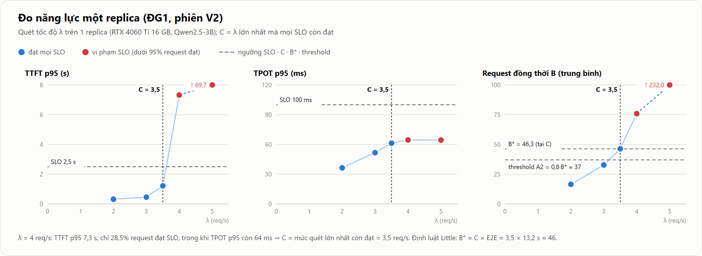

<!-- Mục đích: mục 5.2 của luận văn, năng lực một replica (ĐG1) và kiểm chứng LT1–LT3, bản base lượt 1. Người viết: Trình. Nháp ngày 24/11/2026 từ envs/cloud/experiments/capacity.json, nhật ký Quang tuần 07 (18/11), docs/nhat-ky/van-hanh.md (LT1–LT3) và log vLLM của phiên V2; Trình chưa đọc lại. Quy ước: docs/luan-van/README.md, docs/luan-van/quy-tac-viet.md -->
<!-- Ngân sách (D96): 1,5 trang. Đo 24/11 sau soát số (dàn thử, 1 bảng): 1,07 tr (khuôn A), 1,49 tr (khuôn B); 501 chữ văn xuôi. Số bảng, hình tạm theo mục (Bảng 5.2a, Hình 5.2b thêm 28/11), đánh lại khi ghép chương. -->
<!-- Ý không đưa vào, để chỗ khác: bảng LT1–LT3 đầy đủ (dự đoán, số đo, độ lệch) cho bảng LT ở 5.6 hoặc Phụ lục E; số chi tiết của LT2 ở nhà với Qwen2.5-1.5B (28.672 B/token dự đoán, 28.670 đo, 23/10) và trên A4000 (211.936 token cho 7,28 GiB, 08/11), thân bài chỉ nói hai lần đo này khớp trong sai số làm tròn; điểm chưa giải thích của LT2 ở nhà (thêm 11.040 token trên k3s); bảng 6 mức của LT3 ở nhà (van-hanh.md LT3; thân bài chỉ dùng điểm gãy); LT1 trên laptop 4050 chưa đo; số pod KV L2 của ĐG3 là 224.336 token cho 7,7 GiB (khác pod ĐG1 211.584 token cho 7,26 GiB, chưa rõ vì sao, cùng tỷ lệ B/token); phiên thử A4000 chạy vLLM với 2 lõi CPU mỗi pod (phien-2026-11-08-a4000.md §8), đã đưa vào 5.7 ngày 27/11. -->
<!-- Thông điệp: (1) C = 3,5 req/s và B* = 46,3 trên máy 4060 Ti, nên threshold của A2 là 37; (2) LT1–LT3 khớp số đo, và giới hạn chạm trước tiên là số request đồng thời, đúng tín hiệu mà A2 dùng. -->
<!-- Soát số: 27/11/2026 · Soát văn phong: kiem_van 27/11 · Người viết đọc lại: chưa -->
## 5.2. Năng lực một replica

Phép đo năng lực ĐG1 xác định C của một replica. Cấu hình S1 giữ cố định 1 replica và nhận tải Poisson với tốc độ không đổi, mỗi mức 300 s, bỏ 60 s đầu khi tính (Bảng 5.2a). Kết quả cho thấy C = 3,5 req/s. Khi λ tăng 14,3% lên 4 req/s, SLO attainment chỉ còn 28,5%, đúng dạng điểm gãy của hàng đợi ở mục 2.2. Mức 3,5 chỉ được thêm sau khi thấy điểm gãy. Vì vậy, C thật nằm trong khoảng 3,5–4 req/s, thô hơn bước 0,25 của thiết kế (mục 5.7). Tại C, B\* = 46,3, và threshold của A2 lấy bằng 0,8 × B\* ≈ 37 (mục 3.3).

<!-- nguồn: envs/cloud/experiments/matrix-dg1-v2.yaml (S1, CONST, duration 300, rate 2, 3, 4, 5, 3.5 theo thứ tự đó); capacity.json (window.skip_s 60, window_s 240 mỗi mức, session dg1-v2-4060ti); nhật ký Quang tuần 07 mục 18/11 (λ = 2, 3, 4, 5, "rồi thêm 3,5") -->
<!-- nguồn: capacity.json (C 3.5, B_star 46.3, threshold.A2_concurrency 37); 00-thong-so.md §8.3 (bước 0,25 quanh điểm vi phạm); 4/3,5 = 1,143; lệch Little: |B_server − B_little| / B_server = 0,2% / 0,7% / 0,2% / 4,0% / 25,8% ở λ = 2 / 3 / 3,5 / 4 / 5 (capacity.json, little_ok false chỉ ở λ = 5); Môi trường §8 bước 6 (ngưỡng lệch 15%); C thô do bước 0,5: suy ra từ danh sách mức đo, ghi vào 5.7 -->

**Bảng 5.2a.** Kết quả ĐG1 (RTX 4060 Ti, model 3B), mỗi mức 1 lượt, cửa sổ đo 240 s. B: số request đang chạy và đang chờ trung bình (vLLM); trong ngoặc là λ thực × E2E trung bình, không dùng được ở λ = 5 vì hàng đợi tăng liên tục.

| λ (req/s) | SLO attainment | TTFT p95 (s) | TPOT p95 (ms) | B (Little) | Đang chờ TB |
|---|---|---|---|---|---|
| 2 | 100,0% | 0,3 | 36,4 | 16,4 (16,5) | 0 |
| 3 | 100,0% | 0,5 | 51,7 | 32,7 (32,5) | 0 |
| 3,5 | 100,0% | 1,2 | 61,3 | 46,3 (46,4) | 0,4 |
| 4 | 28,5% | 7,3 | 64,5 | 75,9 (79,0) | 12,4 |
| 5 | 0,0% | 69,7 | 64,3 | 232,0 (291,8) | 168,4 |

<!-- nguồn: capacity.json curves[] (slo_attainment, ttft_p95_s 0,314 / 0,454 / 1,216 / 7,321 / 69,717, tpot_p95_s, B_server, B_little, waiting_mean); 5 lượt valid: true; khớp bảng của nhật ký Quang tuần 07 mục 18/11 -->

Hình 5.2b vẽ ba cột của Bảng 5.2a theo λ, cùng ngưỡng SLO và threshold của A2.

<!-- nguồn: docs/images/png/15-hieu-chinh-nang-luc.png (Hình 15 của docs/chi-tiet/, vẽ lại từ capacity.json ở PR #96 bằng docs/diagrams/build_diagrams.py); ngưỡng SLO: 00-thong-so.md (TTFT ≤ 2,5 s, TPOT ≤ 100 ms); chèn 28/11, lý do chèn dù đã có Bảng 5.2a: hình cho thấy hình dạng điểm gãy và vị trí threshold so với B*, bảng chỉ có số -->

Khi λ vượt C, TTFT p95 tăng vọt qua ngưỡng 2,5 s, còn TPOT p95 đứng yên quanh 64 ms, vẫn cách ngưỡng 100 ms một khoảng lớn. SLO vì thế bị vi phạm do request phải chờ trong hàng đợi, không phải do từng token sinh chậm đi. Threshold 37 của A2 nằm giữa B của hai mức λ = 3 và 3,5, tức trong vùng mà mọi SLO còn đạt.

<!-- nguồn: Bảng 5.2a (TTFT p95 1,2 → 7,3 s, TPOT p95 61,3 → 64,5 → 64,3 ms, đang chờ TB 0,4 → 12,4 → 168,4; B 32,7 và 46,3 ở λ = 3 và 3,5, cả hai mức SLO attainment 100%); capacity.json threshold.A2_concurrency 37 -->

Ba kiểm chứng lý thuyết LT1–LT3 giải thích vì sao C dừng ở mức này. Các LT chỉ kiểm quan hệ giữa các đại lượng, nên một phần số đo lấy từ cluster nhà (RTX 5060, Qwen2.5-1.5B) và phiên thử trên RTX A4000. LT1 dự đoán với một request, TPOT không nhỏ hơn dung lượng weights chia cho băng thông bộ nhớ, vì mỗi bước decode đọc lại toàn bộ weights. Số đo chậm hơn cận dưới này khoảng một phần tư ở cả hai máy: 8,68 so với 6,9 ms ở nhà, 17,2 so với 13,8 ms trên A4000 với model 3B.
<!-- nguồn: docs/chi-tiet/05-moi-truong-danh-gia.md §19 (LT1–LT3 đo ở nhà, thêm V2 nếu không tốn lượt; LT kiểm quan hệ, không báo hiệu năng tuyệt đối) -->

<!-- nguồn LT1: van-hanh.md LT1 (Qwen2.5-1.5B 3,09 GB, RTX 5060 448 GB/s, cận dưới 6,9 ms; 5060: model.safetensors 3.087.467.144 B, 448 GB/s kiểm bằng nvidia-smi clocks.max.memory, vllm bench serve --max-concurrency 1 --num-prompts 20, input 512 / output 256, TPOT p50 8,68 ms, 356 GB/s ≈ 79%, chậm hơn cận dưới 26%); nhật ký Quang tuần 06 (TPOT 3B trên A4000 ở 1 request 17,2 ms, cận dưới 6,17 GB ÷ 448 GB/s ≈ 13,8 ms, ≈ 80%); phien-2026-11-08-a4000.md §10 (vllm bench serve, đồng thời 1: TPOT TB 17,2 ms) -->

Từ C đo thử trên A4000 (4,5 req/s) và tỷ lệ băng thông 288/448, nhóm dự đoán trước phiên V2 rằng C = 3–4 req/s. Số đo nằm trong khoảng này nhưng cao hơn tỷ lệ băng thông thuần (2,9 req/s) 21,0%. Khi có 64 request chạy cùng lúc, TPOT p95 của 4060 Ti chỉ chậm hơn A4000 1,2 lần, gần tỷ lệ C giữa hai máy (1,29). Như vậy, C có thể bám theo TPOT ở batch lớn hơn là theo băng thông. Giả thuyết của nhóm là ở batch lớn, mỗi bước decode tốn thêm một phần tính toán không phụ thuộc băng thông bộ nhớ, làm khoảng cách giữa hai card thu hẹp (chưa kiểm chứng, mục 5.7).

<!-- nguồn: nhật ký Quang tuần 07 mục 18/11 ("Dự đoán trước khi đo: 3–4 req/s (băng thông bộ nhớ 288 so với 448 GB/s của A4000); tỉ lệ băng thông thuần cho 4,5 × 288/448 ≈ 2,9, đo được cao hơn"); 3,5 ÷ (4,5 × 288/448 = 2,893) = 1,210; phien-2026-11-08-a4000.md §12 (ĐG1 thử A4000: C = 4,5, TPOT p95 53,1 ms ở λ = 5 và 52,6 ms ở λ = 6, hàng đợi 30,1 và 179,2 nên số request chạy đã chạm 64; ĐG1 thử, không dùng làm số chính) và §8 (vLLM 2 lõi CPU); capacity.json (TPOT p95 64,5 ms ở λ = 4, 64,3 ms ở λ = 5); 64,4/52,85 ≈ 1,22; 448/288 = 1,556; 4,5/3,5 = 1,286; khoảng C thật: 3,5–4 (V2) và 4,5–5 (A4000, đạt 99,1% ở 4,5 và 6,3% ở 5), nên tỷ lệ C thật nằm trong 1,13–1,43; giả thuyết (bỏ 24/11, đưa lại thân bài 27/11): ở batch lớn, mỗi bước decode tốn thêm phần tính toán không phụ thuộc băng thông, nên khoảng cách giữa hai card thu hẹp (chưa kiểm chứng); V2 không đo TPOT với một request -->

Về dung lượng KV cache, LT2 dự đoán mỗi token chiếm 2 × số lớp × số KV head × head_dim × số byte mỗi phần tử trong KV cache, nên với model 3B là 36.864 B. Phiên V2 đo được 36.843 B (7,26 GiB cho 211.584 token), lệch 0,06%. Hai lần đo trước đó cũng khớp trong sai số làm tròn của vLLM: ở cluster nhà, với Qwen2.5-1.5B, dự đoán 28.672 B và đo được 28.670 B. Trên A4000, cùng model 3B cho 36.883 B (7,28 GiB cho 211.936 token). Do request ngắn, KV cache chỉ dùng 17,5% tại C và 24,0% khi đã có 64 request chạy.

<!-- nguồn: log vLLM pod ĐG1 runs/dg1-v2-4060ti/S1-CONST2-1/attempt-1/logs/vllm-757d499694-7krwm.log ("Available KV cache memory: 7.26 GiB", "GPU KV cache size: 211,584 tokens", "Maximum concurrency for 8,192 tokens per request: 25.83x"); 7,26 × 2³⁰ ÷ 211.584 ≈ 36.843 B, lệch 0,06% (vLLM làm tròn dung lượng tới 0,01 GiB, tức ±0,07%); cấu hình model: nhật ký Quang tuần 05 (36 lớp, 2 KV head, head_dim 128, BF16), docs/chi-tiet/02-kien-thuc-nen.md §1.3; ở nhà và A4000: van-hanh.md LT2 (ở nhà vLLM làm tròn tới 0,1 GiB nên chỉ so được trong khoảng ±2%), nhật ký Quang tuần 06; capacity.json KV_star 0,175, kv_cache_usage 0,240 / 0,241 ở λ = 4 / 5 -->

Về continuous batching, LT3 dự đoán nó làm throughput tăng gần tuyến tính theo số request đồng thời rồi bão hoà ở một điểm gãy gần B\*. Trên V2, điểm gãy nằm giữa λ = 3,5 (B = 46,3) và λ = 4 (B = 75,9), đúng như dự đoán. Tại điểm gãy, số request đang chạy chạm giới hạn 64 của replica. Với 64 token mỗi 62,6 ms (TPOT p50) và output 256 token, suy ra throughput bão hoà khoảng 4,0 req/s, khớp với điểm gãy. Tăng batch vẫn làm chậm từng token: TPOT p50 tăng 53,6% khi B tăng từ 16 lên 46. Dù vậy, TPOT p95 khi bão hoà vẫn dưới 65 ms, nên giới hạn chạm trước tiên là số request đồng thời, cũng là tín hiệu A2 dùng để scale (mục 3.3).

<!-- nguồn: van-hanh.md LT3 (ĐG1-mini 05/11, RTX 5060, max-num-seqs 32, điểm gãy cũng ở lúc số request chạy chạm 32; λ = 6 → 7: TTFT p95 1,35 → 5,28 s, TPOT p50 16,7 → 18,1 ms, λ = 8 vẫn 18,1 ms; số đo LT2 ở nhà và A4000 cũng khớp trong sai số làm tròn; điểm gãy giữa λ = 6 và 7, bão hoà ≈ 32 ÷ 18,1 ms); capacity.json λ = 4: B_server 75,92 − waiting_mean 12,44 = 63,5 request đang chạy (λ = 5: 232,0 − 168,4 = 63,6; con số 63,5 bỏ khỏi thân bài 24/11 vì ngân sách), tpot_p50_s 0,0626; 64 ÷ 0,0626 s ≈ 1.022 token/s ÷ 256 ≈ 3,99 req/s (suy ra, bỏ qua thời gian prefill); TPOT p50 0,0323 s ở λ = 2 (B 16,4) và 0,0496 s ở λ = 3,5 (B 46,3): +53,6%; V2 không có mức B dưới 16, nên vùng batch nhỏ chỉ có số ở nhà (van-hanh.md LT3); --max-num-seqs=64 trong capacity.json vllm.args -->

Cluster nhà cho cùng cơ chế với GPU, model và giới hạn batch khác. Trên RTX 5060, với Qwen2.5-1.5B và tối đa 32 request mỗi batch, điểm gãy nằm giữa λ = 6 và 7, đúng lúc số request đang chạy chạm 32. Qua điểm gãy, TTFT p95 tăng từ 1,35 lên 5,28 s, còn TPOT p50 chỉ tăng từ 16,7 lên 18,1 ms rồi đứng yên và KV cache chỉ dùng khoảng 23%. Hai máy cùng chạm giới hạn số request đồng thời trước bộ nhớ, nên kết luận trên nhiều khả năng không riêng máy 4060 Ti.

<!-- nguồn: van-hanh.md LT3 (ĐG1-mini 05/11, RTX 5060, Qwen2.5-1.5B, max-num-seqs 32; λ = 6: B 27,1, TTFT p95 1,35 s, TPOT p50 16,7 ms, waiting 1,2; λ = 7: B 54,1, TTFT p95 5,28 s, TPOT p50 18,1 ms, waiting 21,8; λ = 8: TPOT p50 18,1 ms; "Điểm gãy ở nhà do max-num-seqs quyết định, không phải bộ nhớ (KV-cache chỉ 23 %)"); LT2 ở nhà và trên A4000 (đoạn trên): van-hanh.md LT2 (1,5B: 28.672 B/token dự đoán, 28.670 đo, 23/10; ở nhà vLLM làm tròn tới 0,1 GiB), nhật ký Quang tuần 06 (A4000 08/11: 211.936 token cho 7,28 GiB); 7,28 × 2³⁰ ÷ 211.936 ≈ 36.883 B, lệch +0,05% so với 36.864, trong sai số làm tròn ±0,07% -->

