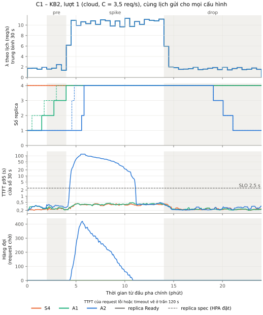

<!-- Mục đích: mục 5.3, autoscaling so với cấu hình tĩnh (ĐG2, Hình C1; Hình C4 sang Phụ lục E). Người viết: Trình. Nháp do agent soạn ngày 21/11/2026 từ gói dữ liệu V2 (runs/v2-vm/v2-dg2/, bảng ở analysis/figures/v2-dg2/) và analysis/dg2_a2.py; một agent khác đối chiếu từng số; 24/11 cắt về ngân sách 3,5 trang (D96); Trình chưa đọc lại. -->
<!-- Số hình, bảng tạm theo mục (Bảng 5.3a, Hình 5.3b) vì 5.1–5.2 chưa có; đánh lại khi ghép chương. Ý đã cắt khi rút gọn 24/11, dùng lại được cho Phụ lục E hoặc chương 6: Hình C4 (analysis/figures/v2-dg2/c4-tradeoff-cloud.svg, SLO attainment theo GPU-giờ); A1 × KB1 tiết kiệm 10,3% và 9,4% (một lượt dưới ngưỡng); pod cũ xử lý 3,60–3,78 req/s so với 2,41–2,83 của pod mới, hàng đợi pod cũ chỉ giảm từ 370–400 xuống 38–80 trong giây 360–600 (dg2_a2 phần 3); pha tăng dần của KB3: A2 trung bình 2,06–2,16 replica, SLO 84,1% và 79,9% (pha không chấm), A1 100%, vì A1 lên 2 replica ở giây 20, A2 ở giây 65 và 70 (phases.csv, events.jsonl); A1 bớt pod 308–315 s sau khi kịch bản tải kết thúc; pha duy trì của KB3: 65–74% số mẫu tải chỉ đòi ≤ 3 replica nhưng mẫu đòi 4 replica cách nhau ≤ 120 s, ngắn hơn cửa sổ ổn định, nên A2 giữ 4 replica suốt pha (metrics.csv.gz A2-KB3-1/2, dg2_a2 phần 4). -->

## 5.3. Autoscaling so với cấu hình tĩnh

Mục này so A2 với hai cấu hình tĩnh S1, S4 và với A1 trên ba kịch bản tải của mục 3.6. Ma trận gồm 17 lượt trên 11 ô, chạy trong phiên đo trên 4 × RTX 4060 Ti (mục 5.1). Cả 17 lượt hợp lệ, đều bắt đầu khi image, model và compile cache đã có sẵn trên node (mục 3.4), và các lượt cùng số thứ tự lặp dùng chung một lịch gửi request.

<!-- nguồn: analysis/figures/v2-dg2/runs.csv (17 dòng, valid = True, capacity_rps 3,5 (mục 5.2), threshold 37, max_replicas 4); nhật ký Quang tuần 07 mục 18/11 (ĐG2 17/17 hợp lệ; C = 3,5, B\* = 46,3, threshold 37); Thông số §7 (KB1 0,5 C; đỉnh KB2, KB3 0,75 × N = 3,0 C), §8.1 (A1 target 70), §8.2 (ma trận 17 lượt, lịch gửi chung theo lần lặp, mọi lượt ở L2); runs.csv n_sent: A1-KB2-1 và A2-KB2-1 cùng 7.771 request, A1-KB1-2 và A2-KB1-2 cùng 1.326 -->

### 5.3.1. SLO attainment và GPU-giờ theo cấu hình

Theo quy tắc so sánh ở mục 3.6, hai cấu hình chỉ được coi là khác nhau khi mọi lượt cùng chiều và chênh lệch vượt ngưỡng thực tiễn. Ngưỡng là 5 điểm phần trăm SLO attainment, hoặc 10% GPU-giờ. Bảng 5.3a ghi kết quả từng ô; số của từng lượt và hình đặt SLO attainment theo GPU-giờ nằm ở Phụ lục E.

<!-- nguồn: Thông số §6 (ngưỡng thực tiễn 5 điểm phần trăm, 10% GPU-giờ; mọi lượt cùng chiều) -->

**Bảng 5.3a.** Kết quả ĐG2 theo ô (phiên đo V2, 4 × RTX 4060 Ti, model 3B). Ô có nhiều lượt ghi khoảng từ thấp nhất tới cao nhất. SLO attainment và TTFT p95 tính trên các pha được chấm (KB1: pha ổn định; KB2: pha nền, tăng đột ngột và giảm; KB3: pha duy trì); request lỗi và GPU-giờ tính trên cả kịch bản. "–": không có request thành công.

| Ô | Số lượt | SLO attainment (%) | TTFT p95 (s) | Request lỗi | GPU-giờ | So với S4 (%) |
|---|---|---|---|---|---|---|
| S4 × KB1 | 1 | 100 | 0,22 | 0 | 0,80 | 100 |
| A1 × KB1 | 2 | 100 | 0,22–0,24 | 0 | 0,72 | 89,7–90,6 |
| A2 × KB1 | 2 | 100 | 0,32 | 0 | 0,20 | 25 |
| S1 × KB2 | 1 | 12,5 | 93,1 | 5.659 | 0,40 | 25 |
| S4 × KB2 | 1 | 100 | 0,38 | 0 | 1,60 | 100 |
| A1 × KB2 | 2 | 100 | 0,38–0,39 | 0 | 1,52–1,53 | 95,1–95,4 |
| A2 × KB2 | 3 | 79,4–80,7 | 73,3–79,0 | 37–93 | 1,15–1,20 | 71,8–75,2 |
| S1 × KB3 | 1 | 0,0 | – | 8.008 | 0,28 | 25 |
| S4 × KB3 | 1 | 100 | 0,40 | 0 | 1,13 | 100 |
| A1 × KB3 | 1 | 100 | 0,40 | 0 | 1,05 | 92,7 |
| A2 × KB3 | 2 | 100 | 0,40 | 0 | 1,04–1,05 | 91,7–92,3 |

<!-- nguồn: analysis/figures/v2-dg2/runs.csv, cột slo_attainment, ttft_p95_s, n_error, gpu_h, gpu_vs_baseline, scored_phases; cells.csv (n_runs); nhật ký Quang tuần 07 mục 18/11 (bảng 11 ô, cùng số sau khi làm tròn). Mọi lỗi là Timeout (cột error_types). Từng lượt: A1-KB1 0,24; 0,22 s, 89,7; 90,6%; A1-KB2 1,53; 1,52, 95,4; 95,1%, 0,39; 0,38 s; A2-KB2 79,8; 79,4; 80,7%, 79,0; 77,9; 73,3 s, 37; 82; 93 lỗi, 1,20; 1,15; 1,16, 75,2; 71,8; 72,2%; A2-KB3 1,04; 1,05, 91,7; 92,3% -->

Chỉ ở tải thấp ổn định, autoscaling vừa giữ SLO vừa tiết kiệm GPU-giờ vượt ngưỡng. Ở kịch bản này, A2 giữ 1 replica và chỉ dùng 25% GPU-giờ của cấu hình tĩnh 4 replica, trong khi SLO attainment vẫn là 100%. Mức này đạt chỉ tiêu N3 (không quá 50%), và chỉ tiêu N1 (ít nhất 95% ở tải ổn định) cũng đạt ở cả bốn lượt. Ở kịch bản tải cao kéo dài, cả hai cấu hình autoscaling dùng 91,7–92,7% GPU-giờ của S4, tiết kiệm dưới ngưỡng 10%, nên không khác cấu hình tĩnh.

<!-- nguồn: runs.csv: A2-KB1-1/2 replicas_max 1, gpu_vs_baseline 0,25, slo_delta_vs_baseline_pp 0; A1-KB3-1 0,927411, A2-KB3-1/2 0,916557 và 0,922614; A2-KB1, A2-KB3 slo_attainment 1,0 (N1 chấm pha steady của KB1, sustain của KB3); S1-KB2-1 slo 0,124719, n_error 5.659; S1-KB3-1 slo 0,0, n_error 8.008. Thông số §4 (N1 ≥ 95%, N3 ≤ 50% và kém không quá 5 điểm) -->

Kịch bản tăng đột ngột là nơi duy nhất buộc phải đánh đổi. Ở đây A2 tiết kiệm 24,8–28,2% GPU-giờ, nhưng SLO attainment kém S4 19,3–20,6 điểm phần trăm, cả hai vượt ngưỡng ở mọi lượt. A1 giữ 100% nhưng chỉ tiết kiệm 4,6–4,9% GPU-giờ, nên không khác cấu hình tĩnh.

<!-- nguồn: runs.csv: A2-KB2-1/2/3 gpu_vs_baseline 0,752028; 0,717897; 0,722459, slo_delta_vs_baseline_pp −20,18; −20,56; −19,26; A1-KB2-1/2 slo 1,0, gpu_vs_baseline 0,953713; 0,9514 (tiết kiệm 4,6–4,9%). S1 (12,5% ở KB2, 0% ở KB3) chỉ còn trong bảng -->

### 5.3.2. Phản ứng khi tải tăng đột ngột

Autoscaling thêm replica kịp thời nhưng vẫn không giữ được SLO. Pod mới đầu tiên được tạo 14,7–16,4 s sau khi tải bắt đầu tăng và Ready sau thêm 65–66 s cold start (mục 5.4). Thời gian phản ứng 79,7–81,5 s (3 lượt) đạt chỉ tiêu N2a (không quá 2 phút). Đúng như LT7 dự đoán, phần lớn khoảng này là cold start, vì HPA đã đặt đủ 4 replica chỉ sau 30–36 s. Dù vậy, SLO attainment của pha tăng đột ngột chỉ là 74,8–76,2%, với 37–93 request timeout mỗi lượt. TTFT p95 chỉ trở lại dưới ngưỡng 2,5 s sau 409–430 s, dài hơn mức dự kiến 5 phút của N2b.

<!-- nguồn: runs.csv A2-KB2-1/2/3: replicas_at_rise 1, detect_s 16,42; 15,53; 14,71, create_to_ready_s 65; 66; 65, react_s 81,42; 81,53; 79,71 (khoảng dư nhỏ nhất 38,5 s), recovery_s 426; 430; 409, error_types Timeout; events.jsonl (SuccessfulRescale, analysis/dg2_a2.py phần 1): 4 replica lúc 271, 276, 270 s, tải tăng lúc 240 s; phases.csv pha spike: slo_attainment 0,753792; 0,748413; 0,76192, n_error 37; 82; 93; nhật ký Quang tuần 07 mục 19/11 (lỗi đều ở pha spike). van-hanh.md LT7 (HPA quyết định < 11 s; phần lớn N2a là cold start). Thông số §4 (N2a, N2b), §6 (SLO TTFT 2,5 s), §7 (timeout 120 s) -->

Hình 5.3b cho thấy nguyên nhân là hàng đợi dồn vào pod có sẵn. Hai lượt còn lại của A2 cho cùng hình dạng. Trong khoảng 80 s chờ replica mới, mọi request vào pod duy nhất trong khi tải đã gấp 3 lần năng lực của nó. Hàng đợi trong vLLM của pod này lên 416–428 request và chỉ hết sau 402–414 s. Ba pod mới có nhiều nhất 9 request chờ, cấu hình tĩnh không có request chờ nào.

<!-- nguồn: nhật ký Quang tuần 07 mục 19/11 (hàng đợi pod cũ 416/425/428 trong khoảng 385–390 s, pod mới 0–9, S4 0 request chờ); kiểm lại trên runs/v2-vm/v2-dg2/{A2,S4}-KB2-*/attempt-1/metrics.csv.gz (vllm_waiting theo pod; mẫu > 0 cuối cùng ở 649, 654, 642 s, tức 409, 414, 402 s sau lúc tải tăng 240 s): analysis/dg2_a2.py phần 2 -->

Hàng đợi rút chậm vì Service của Kubernetes chia request mới đều cho các pod Ready, không xét hàng đợi trong từng pod. Từ giây 360 tới giây 600, khi cả bốn pod đã Ready, pod cũ vẫn nhận 24,3–25,7% số request mới, nên 69–75% số request nó xử lý xong chỉ bù cho request mới đến. Trong số request không đạt SLO của pha tăng đột ngột, 42–44% được gửi trước khi pod mới đầu tiên Ready; phần lớn số còn lại nhiều khả năng xếp sau hàng đợi cũ. Như vậy, điểm nghẽn ở kịch bản này nằm ở cold start và cách chia request, không nằm ở tín hiệu scale. Chương 6 bàn hai hướng chưa kiểm chứng: định tuyến tới pod ít request chờ nhất, hoặc giữ tối thiểu 2 replica.

<!-- nguồn: access log runs/v2-vm/v2-dg2/A2-KB2-*/attempt-1/logs/vllm-*.log (dòng "POST /v1/chat/completions" theo pod; tổng cả lượt bằng đúng n_sent 7.771; 7.730; 7.846, tổng trong cửa sổ bằng số request gửi 2.498; 2.572; 2.517); pod cũ nhận 642; 650; 611, xử lý xong (Δ vllm_success_total) 908; 863; 880, tức 3,60–3,78 req/s so với 2,41–2,83 req/s của pod mới: dg2_a2 phần 3; requests.csv, t_sched trong [240; 840) s, SLO như analysis/metrics.py (khớp phases.csv): không đạt gửi trước lúc pod mới đầu tiên Ready (321,4; 321,5; 319,7 s) 635; 651; 647, sau đó 891; 895; 826 (dg2_a2 phần 5) -->

<!-- nguồn: chi phí của hướng giữ 2 replica (để chương 6): ước tính 2 replica × 12 phút = 0,40 GPU-giờ so với 0,80 của S4 × KB1 (runs.csv gpu_h); Thông số §4 (N3 ≤ 50%); nhật ký Quang tuần 07 mục 19/11 (hướng "routing theo hàng đợi" chưa thử) -->

### 5.3.3. Scale-down và độ ổn định của số replica

Khi tải giảm, autoscaling bớt replica từng bước mà không gây lỗi. Pod đầu tiên bị bớt sau 190–299 s và số replica về 1 sau 369–420 s. Nhịp này khớp cấu hình bớt tối đa 1 pod mỗi 60 s (mục 3.3). Bước đầu đến trước 300 s, nhiều khả năng vì cửa sổ ổn định tính từ đề xuất cao gần nhất, không từ lúc tải giảm. Trong pha giảm, cả ba lượt có 0 request lỗi trên 1.147–1.245 request và SLO attainment 100%, nên phần scale-down của chỉ tiêu N4 đạt. Không lượt nào có flapping.

<!-- nguồn: events.jsonl A2-KB2-1/2/3 (dg2_a2 phần 1): 4→3 lúc 1139; 1030; 1068 s, 3→2 lúc 1200; 1155; 1148 s, 2→1 lúc 1260; 1215; 1209 s; tải giảm lúc 840 s (Thông số §7); phases.csv pha drop: n_sent 1.147; 1.166; 1.245, n_error 0, slo_attainment 1,0; runs.csv scale_downs 3, flaps = 0 ở cả 17 lượt. Thông số §9.3 (stabilizationWindowSeconds 300, 1 pod mỗi 60 s), §4 (N4). Bước sớm ở lượt 2, 3: metrics.csv.gz (vllm_running + vllm_waiting cộng mọi pod), mẫu > 111 (3 × threshold 37) cuối ở 839; 749; 767 s (dg2_a2 phần 4). Lượt 2 không khớp: 749 + 300 = 1.049 s > 1.030 s, nên metric ghi trong metrics.csv.gz chưa chắc là giá trị HPA nhận (chu kỳ lấy mẫu, truy vấn của KEDA); chưa kiểm, vì vậy câu trong bài ghi "nhiều khả năng" -->

### 5.3.4. Vì sao không dùng GPU utilization làm tín hiệu

Số đo xác nhận lý do nhóm không scale theo GPU utilization (mục 3.3). Ở tải thấp, 1 replica là đủ, nhưng A1 đã lên 4 replica sau 166–181 s. GPU utilization chỉ đo tỷ lệ thời gian GPU có kernel đang chạy (mục 2.3), nên bão hoà ngay ở tải thấp. Khi mỗi replica chỉ nhận khoảng 0,125 C, chỉ số này trung bình vẫn là 93%. Phép kiểm LT6 trên dữ liệu đo năng lực cũng cho thấy GPU utilization không tách được tải vừa khỏi quá tải. SLO attainment 100% của A1 vì vậy đến từ việc chạy gần như cấu hình tĩnh.

<!-- nguồn: events.jsonl A1-KB1-1/2 (dg2_a2 phần 1): lên 2, 3, 4 replica lúc 15/15, 100/91, 181/166 s; runs.csv A1-KB1 replicas_max 4, scale_downs 0; runs.csv S4-KB1-1 gpu_util_mean 0,931024, capacity_rps 3,5 (0,5 C ÷ 4 replica = 0,125 C); Thông số §8.1 (A1 target 70), §9.3 (tolerance 10%: A1 thêm pod khi util > 70 × 1,1 = 77%); van-hanh.md LT6 (A1 thêm pod khi util mỗi pod > 77%; V2: util không tách được, A2 hở 4,6×); runs.csv A1-KB2-1/2 replicas_at_rise 4; gpu_vs_baseline A1-KB2-1/2 0,953713; 0,9514, A1-KB3-1 0,927411 (tiết kiệm 4,6–7,3%); A2 replicas_max 1 (KB1), 4 (KB2, KB3); events.jsonl A2-KB2 về 1 replica -->
