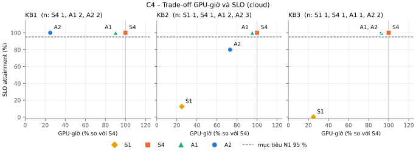

<!-- Mục đích: Phụ lục E, số liệu từng lượt của phiên đo V2 (ĐG2, cảnh báo VH6, ĐG3, các kịch bản VH), mà mục 5.3, 5.4, 5.5 và 5.6 dẫn tới. Người viết: Trình. -->
<!-- Số lấy ngày 27/11/2026: Bảng E.1–E.3 sinh bằng script tạm đọc analysis/figures/v2-dg2/runs.csv và alerts.csv (do analysis/build_tables.py tạo từ runs/v2-vm/v2-dg2/), làm tròn theo quy tắc viết; Bảng E.4 lấy từ comment đầu 05-04-cold-start.md (đã soát số 24/11, nguồn summary.txt và vllm_log.json của 5 lượt trong runs/v2-vm/dg3-v2-4060ti/); Bảng E.5 đọc lại summary.json và timeline.json trong runs/v2-vm/ops-*-20261118-*/. Dữ liệu thô không nằm trong Git (đóng gói bộ dữ liệu là việc P4, Kế hoạch §10.6). Không đưa vào: bảng nghiệm thu đầy đủ kèm cột Ghi chú (bản nháp commit bb14810), các lượt chạy thử trên máy 2 × RTX 4000 Ada và simulator, bảng kiểm chứng LT1–LT8. -->

# Phụ lục E. Số liệu từng lượt của phiên đo V2 {.unnumbered}

Phụ lục này ghi số của từng lượt trong phiên đo V2 (4 × RTX 4060 Ti, model 3B, ngày 18–19/11/2026), mà chương 5 chỉ báo cáo theo ô hoặc theo khoảng giá trị. Số của Bảng E.1–E.3 lấy từ các bảng mà script trong thư mục `analysis/` của repository dựng từ dữ liệu thô. Số của Bảng E.4 và E.5 đọc từ file kết quả của từng lượt. Thời điểm trong các bảng tính bằng giây kể từ lúc máy tạo tải bắt đầu gửi request của lượt đó.
<!-- nguồn: nhật ký Quang tuần 07 mục 18/11 và 19/11 (V2: 4 × RTX 4060 Ti; ĐG2 17/17 lượt hợp lệ; VH; ĐG3 đo lại); analysis/figures/v2-dg2/runs.csv (cột t0_unix, model và image ghi trong metadata của lượt) -->

## E.1. So sánh autoscaling với cấu hình tĩnh (ĐG2)

Bảng E.1 ghi 17 lượt của ma trận ĐG2, theo thứ tự cấu hình rồi kịch bản, không theo thứ tự chạy. Cách tính giống Bảng 5.2: SLO attainment và TTFT p95 tính trên các pha được chấm, còn số request, lỗi và GPU-giờ tính trên cả kịch bản. Mọi request lỗi trong ma trận đều là timeout phía máy tạo tải.
<!-- nguồn: analysis/figures/v2-dg2/runs.csv (n_sent, n_error, error_types chỉ có Timeout=…, slo_attainment, ttft_p95_s, gpu_h, gpu_vs_baseline, replicas_ready_mean, scale_changes, pages; scored_phases: KB1 steady, KB2 pre+spike+drop, KB3 sustain) -->

**Bảng E.1.** Kết quả từng lượt của ĐG2. GPU-giờ (% S4): GPU-giờ so với cấu hình tĩnh 4 replica cùng kịch bản. Replica Ready: số replica Ready trung bình trong lượt. Đổi số replica: số lần HPA đổi số replica mong muốn. "–": không có request thành công.

| Lượt | Request gửi / lỗi | SLO attainment (%) | TTFT p95 (s) | GPU-giờ | GPU-giờ (% S4) | Replica Ready | Đổi số replica | Page |
|---|---|---|---|---|---|---|---|---|
| A1 × KB1, lượt 1 | 1.229 / 0 | 100,0 | 0,24 | 0,718 | 89,7 | 3,25 | 3 | 0 |
| A1 × KB1, lượt 2 | 1.326 / 0 | 100,0 | 0,22 | 0,725 | 90,6 | 3,32 | 3 | 0 |
| A1 × KB2, lượt 1 | 7.771 / 0 | 100,0 | 0,39 | 1,526 | 95,4 | 3,66 | 3 | 0 |
| A1 × KB2, lượt 2 | 7.730 / 0 | 100,0 | 0,38 | 1,522 | 95,1 | 3,65 | 3 | 0 |
| A1 × KB3, lượt 1 | 9.287 / 0 | 100,0 | 0,40 | 1,051 | 92,7 | 3,49 | 3 | 0 |
| A2 × KB1, lượt 1 | 1.229 / 0 | 100,0 | 0,32 | 0,200 | 25,0 | 1,00 | 0 | 0 |
| A2 × KB1, lượt 2 | 1.326 / 0 | 100,0 | 0,32 | 0,200 | 25,0 | 1,00 | 0 | 0 |
| A2 × KB2, lượt 1 | 7.771 / 37 | 79,8 | 78,98 | 1,203 | 75,2 | 2,79 | 5 | 1 |
| A2 × KB2, lượt 2 | 7.730 / 82 | 79,4 | 77,94 | 1,149 | 71,8 | 2,67 | 5 | 1 |
| A2 × KB2, lượt 3 | 7.846 / 93 | 80,7 | 73,32 | 1,156 | 72,2 | 2,70 | 5 | 1 |
| A2 × KB3, lượt 1 | 9.287 / 0 | 100,0 | 0,40 | 1,039 | 91,7 | 3,43 | 3 | 1 |
| A2 × KB3, lượt 2 | 9.511 / 0 | 100,0 | 0,40 | 1,046 | 92,3 | 3,46 | 3 | 1 |
| S1 × KB2, lượt 1 | 7.771 / 5.659 | 12,5 | 93,10 | 0,400 | 25,0 | 1,00 | 0 | 1 |
| S1 × KB3, lượt 1 | 9.287 / 8.008 | 0,0 | – | 0,283 | 25,0 | 1,00 | 0 | 1 |
| S4 × KB1, lượt 1 | 1.229 / 0 | 100,0 | 0,22 | 0,800 | 100,0 | 4,00 | 0 | 0 |
| S4 × KB2, lượt 1 | 7.771 / 0 | 100,0 | 0,38 | 1,600 | 100,0 | 4,00 | 0 | 0 |
| S4 × KB3, lượt 1 | 9.287 / 0 | 100,0 | 0,40 | 1,133 | 100,0 | 4,00 | 0 | 0 |
<!-- nguồn: analysis/figures/v2-dg2/runs.csv, 17 dòng; GPU-giờ (% S4) = gpu_vs_baseline × 100; A2 × KB2: scale_ups 2, scale_downs 3; số request khác nhau giữa các lượt cùng kịch bản vì lịch gửi sinh từ seed theo lượt (n_planned = n_sent) -->

Hình E.1 đặt từng lượt lên mặt phẳng GPU-giờ và SLO attainment, mỗi kịch bản một ô. Điểm nằm bên trái vạch 100% là dùng ít GPU hơn cấu hình tĩnh 4 replica, điểm nằm dưới vạch ngang là không đạt mục tiêu SLO 95%.
<!-- nguồn: analysis/charts.py plot_c4 (axvline 100, axhline m.ATTAINMENT × 100); 00-thong-so.md (SLO 95%) -->

<!-- nguồn: analysis/figures/v2-dg2/c4-tradeoff-cloud.svg, vẽ bằng analysis/charts.py plot_c4 (trục hoành GPU-giờ % S4, trục tung SLO attainment, vạch m.ATTAINMENT × 100 = 95, vạch dọc 100) -->

## E.2. Phản ứng của A2 khi tải tăng đột ngột

Bảng E.2 tách thời gian phản ứng của A2 ở ba lượt KB2 thành hai phần. Phần phát hiện tính từ lúc tải tăng theo lịch tới khi pod mới đầu tiên được tạo, gồm thời gian KEDA đọc metric và HPA tính số replica. Phần còn lại tính từ lúc tạo pod tới khi pod mới đầu tiên Ready.
<!-- nguồn: analysis/metrics.py reaction() (detect_s: t_rise → pod mới đầu tiên được tạo; react_s: t_rise → pod mới đầu tiên Ready; create_to_ready_s = react_s − detect_s; mốc tạo pod theo API server, chính xác tới 1 s) -->

**Bảng E.2.** Thời gian phản ứng của A2 × KB2 (s)

| Lượt | Phát hiện | Tạo pod tới Ready | Tổng (chỉ tiêu N2a ≤ 120 s) |
|---|---|---|---|
| A2 × KB2, lượt 1 | 16,4 | 65 | 81,4 |
| A2 × KB2, lượt 2 | 15,5 | 66 | 81,5 |
| A2 × KB2, lượt 3 | 14,7 | 65 | 79,7 |
<!-- nguồn: analysis/figures/v2-dg2/runs.csv (detect_s 16,418434 / 15,534563 / 14,712365; create_to_ready_s 65 / 66 / 65; react_s 81,418434 / 81,534563 / 79,712365); 00-thong-so.md §4 (N2a ≤ 2 phút) -->

## E.3. Thời gian từ vi phạm SLO tới page (VH6)

Bảng E.3 ghi 7 lượt có cảnh báo `LLMSLOBurnFast` (mức page). Mốc vi phạm là lần đầu tỷ lệ request xấu theo log của máy tạo tải, trên cửa sổ 1 phút, vượt 20%. Request xấu là request lỗi hoặc không đạt ngưỡng TTFT, TPOT. Cột cuối tính tỷ lệ request xấu trên cửa sổ 5 phút kết thúc lúc page, để kiểm page đó có phải page giả không. Ngưỡng page giả là 20%. Mốc page lấy theo chuỗi `ALERTS` của Prometheus, chưa gồm thời gian chờ gom nhóm của Alertmanager.
<!-- nguồn: analysis/metrics.py slo_violation_start() (cửa sổ 60 s, ngưỡng BAD_RATIO_PAGE 20 %, chỉ xét từ start + 60 s), classify_alerts (client_bad_ratio trên cửa sổ 5 phút kết thúc ở lúc firing; page giả khi < 20 %); analysis/vh6_window.py; comment đầu 05-05 (ALERTS lấy mẫu 5 s, rule tính 15 s, thời gian tới page chưa gồm group_wait 30 s) -->

**Bảng E.3.** Mốc vi phạm SLO và mốc page của từng lượt (s)

| Lượt | Vi phạm từ | Page lúc | Thời gian tới page | Request xấu trong 5 phút trước page (%) |
|---|---|---|---|---|
| A2 × KB2, lượt 1 | 265 | 374,2 | 109,2 | 52,1 |
| A2 × KB2, lượt 2 | 263 | 373,7 | 110,7 | 52,5 |
| A2 × KB2, lượt 3 | 260 | 362,4 | 102,4 | 54,1 |
| A2 × KB3, lượt 1 | 119 | 219,0 | 100,0 | 27,2 |
| A2 × KB3, lượt 2 | 102 | 203,8 | 101,8 | 37,8 |
| S1 × KB2, lượt 1 | 265 | 364,3 | 99,3 | 73,4 |
| S1 × KB3, lượt 1 | 120 | 224,5 | 104,5 | 67,8 |
<!-- nguồn: analysis/figures/v2-dg2/runs.csv (slo_violation_s, slo_alert_s, time_to_alert_s, false_pages 0 ở mọi lượt); alerts.csv dòng LLMSLOBurnFast (first_s trùng slo_alert_s, client_bad_ratio 0,521406 / 0,525079 / 0,540706 / 0,272… / 0,378… / 0,734… / 0,678…, false_page False); A2 × KB3 lượt 2 có thêm một đợt LLMSLOBurnFast còn kêu từ lượt chạy trước lúc bắt đầu (alerts_at_start), không chấm -->

Cả 7 page đều kêu khi tỷ lệ request xấu đã vượt 20%, nên không có page giả. Bảng không tính một đợt page còn kêu từ lượt trước khi lượt 2 của A2 × KB3 bắt đầu, vì đợt đó không thuộc lượt nào được chấm. Ngoài các lượt trên, cảnh báo `KubeHpaMaxedOut` (mức warning, của chart kube-prometheus-stack) kêu ở các lượt chạy lâu ở 4 replica, và hai cảnh báo lỗi gửi tin của Alertmanager kêu sẵn từ đầu mọi lượt. Không cảnh báo nào trong số này ở mức page.
<!-- nguồn: alerts.csv (false_page False ở 7 dòng LLMSLOBurnFast; KubeHpaMaxedOut warning ở 5 lượt A1 × KB2 lượt 1, 2, A1 × KB3, A2 × KB3 lượt 1, 2; AlertmanagerClusterFailedToSendAlerts critical, AlertmanagerFailedToSendAlerts warning, firing_at_start True ở mọi lượt); lý do Alertmanager báo lỗi gửi: chưa ghi ở phụ lục này (5.5.3, 5.7) -->

## E.4. Cold start (ĐG3)

Bảng E.4 ghi thời gian từng pha của 5 lượt cold start, chia theo 8 pha như Bảng 5.3. Lần chạy đầu của L2-1, L2-3 và L0-1 dừng sớm do lỗi của script đo nên được đo lại; bảng ghi lần đo lại.
<!-- nguồn: comment đầu 05-04-cold-start.md (số từng lượt, chính xác tới 0,1 s); runs/v2-vm/dg3-v2-4060ti/ (5 thư mục hợp lệ, 3 thư mục *-failed-wait-count-bug của lần chạy đầu L2-1, L2-3, L0-1; nhật ký Quang tuần 07 mục 19/11) -->

**Bảng E.4.** Thời gian từng pha cold start của từng lượt (s). Thứ tự đo thực tế: L2-2, L0-2, L2-1, L2-3, L0-1.

| Pha | L0-1 | L0-2 | L2-1 | L2-2 | L2-3 |
|---|---|---|---|---|---|
| 1–3. Scheduling, chuẩn bị pod, kéo image | 158,0 | 156,0 | 1,5 | 1,5 | 1,7 |
| – trong đó kéo image | 156,0 | 154,1 | 0 | 0 | 0 |
| 4. Khởi động tiến trình | 50,3 | 46,1 | 43,0 | 42,9 | 42,6 |
| 5. Tải model từ Hugging Face | 54,2 | 56,8 | 0 | 0 | 0 |
| 6. Khởi tạo model và nạp weights | 6,7 | 6,1 | 13,6 | 13,3 | 13,4 |
| – trong đó nạp weights (log vLLM) | 1,14 | 0,99 | 7,79 | 7,71 | 7,78 |
| 7. Compile, KV cache, CUDA graph | 34,9 | 31,9 | 13,7 | 13,6 | 16,1 |
| – trong đó torch.compile | 20,22 | 18,01 | 1,29 | 1,23 | 1,26 |
| 8. Mở cổng và chờ probe | 6,6 | 3,8 | 3,9 | 4,4 | 7,1 |
| **Từ lệnh scale tới Ready** | **310,7** | **300,7** | **75,7** | **75,7** | **80,8** |
<!-- nguồn: comment đầu 05-04-cold-start.md; tổng = ready_seen_unix − trigger_unix (summary.txt ghi trigger_to_ready_s nguyên giây 311 / 300 / 76 / 76 / 81); kéo image theo pull_events "in 2m35.958s" (L0-1), "2m34.077s" (L0-2); thứ tự đo theo trigger_unix (comment 05-04 dòng 4); L2-3 cộng các pha ra 80,9 do làm tròn từng pha -->

## E.5. Các kịch bản vận hành

Bảng E.5 ghi các lượt kịch bản vận hành chạy trên V2, mỗi kịch bản một lượt, cùng tải không đổi 1,75 req/s. Số request và lỗi tính trên cả lượt tải, nên các lượt dài ngắn khác nhau có số request khác nhau.
<!-- nguồn: runs/v2-vm/ops-*-20261118-*/summary.json (load.requests, load.errors), load/loadgen.json (rate_rps 1.75 ở cả 6 lượt); comment 05-05 (load/loadgen.json duration_s 1200 cho vh2a, 2400 cho vh2b, 780 cho vh3-delete) -->

**Bảng E.5.** Kết quả các kịch bản vận hành trên V2

| Kịch bản | Thao tác | Request / lỗi | Thời gian | Ghi chú |
|---|---|---|---|---|
| VH2a | Rolling update, 2 replica trên 4 GPU | 2.077 / 0 | Hoàn tất sau 141,4 s | Bắt đầu từ 1 replica, nâng tối thiểu lên 2 và chờ đủ 2 pod Ready rồi mới cập nhật |
| VH2b | Rolling update, 4 replica trên 4 GPU | 4.229 / 0 | Hoàn tất sau 371,6 s | Pod mới phải chờ pod cũ nhả GPU |
| VH2c | Rolling update với `maxSurge: 1` khi hết GPU | 2.077 / 0 | Kẹt sau 300,5 s | 1 pod Pending; trả `maxSurge` về 0 thì hoàn tất sau 379,1 s |
| VH3, xoá pod | Xoá 1 trong 2 pod | 1.351 / 0 | Pod thay thế Ready sau 67,4 s | |
| VH3, kill | `kill -9` tiến trình vLLM trong container | 1.041 / 129 | Container Ready lại sau 67,4 s | 70 lỗi kết nối, 47 timeout kết nối, 11 lỗi stream, 1 lỗi HTTP |
| VH4 | Chặn KEDA tới Prometheus 301 s | 1.263 / 0 | Fallback sau 16,8 s | Lên 4 replica; thoát fallback trong không quá 5,3 s sau khi gỡ chặn |
<!-- nguồn: ops-vh2a-20261118-164653/summary.json (2077 / 0, rollout_s 141,39, replicas_before 1), timeline.json (min_replicas_2, two_ready trước rollout_start; experiments/ops/vh.py vh2a); ops-vh2b-20261118-170715/summary.json (4229 / 0, rollout_s 371,55), timeline.json (all_gpus_filling replicas 4); ops-vh2c-20261118-174729/summary.json (2077 / 0, rollout_stuck true, pending_pods 1), timeline.json (rollout_start → after_wait 300,5 s, after_wait → restored 379,1 s); experiments/ops/vh.py (vh2c: set_strategy(1, 0)); ops-vh3-delete-20261118-180750/summary.json (1351 / 0, replace_s 67,38, ready_before 2); ops-vh3-kill-20261118-182107/summary.json (1041 / 129, by_error ConnectError 70, ConnectTimeout 47, StreamError 11, HTTPStatus 1; recover_s 67,45); ops-vh4-20261118-183127/summary.json (1263 / 0, fallback_s 16,80, max_replicas 4), timeline.json (block_prometheus → unblocked 301,0 s, unblocked → signal_back 5,31 s) -->
