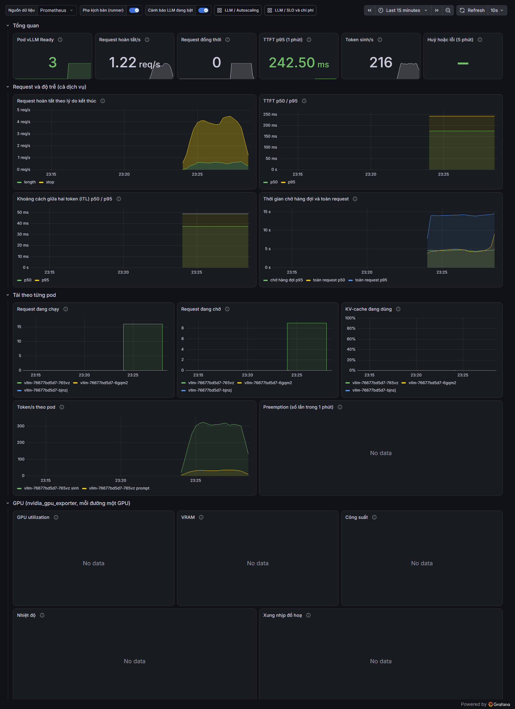
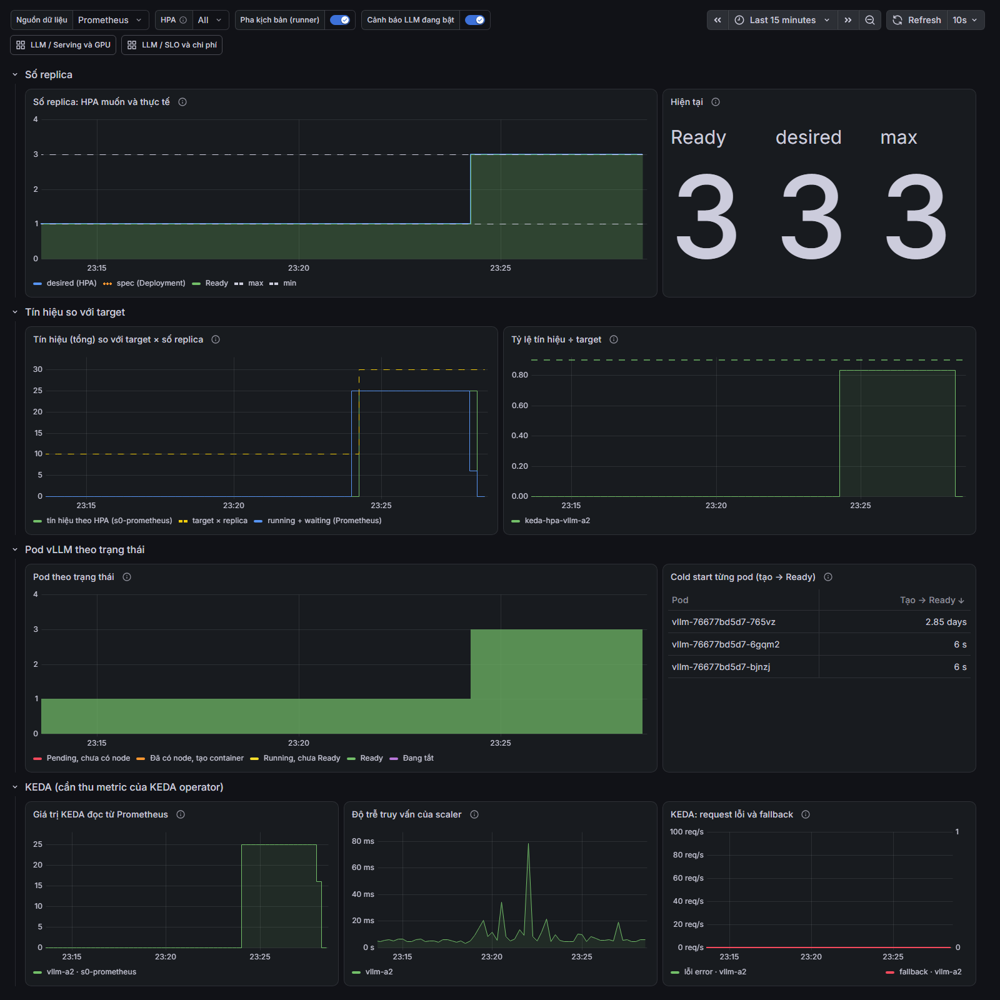
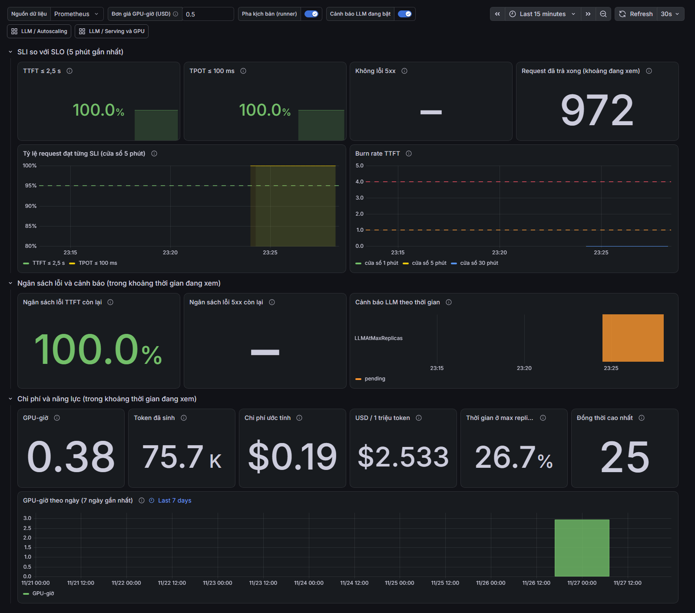

<!-- Mục đích: Phụ lục G, ảnh ba dashboard Grafana chụp trên simulator, mà mục 4.6 và Bảng 5.4 (dòng F5) dẫn tới. Ảnh dự phòng cho F5 khi chưa có ảnh chụp trên GPU thật ở cluster nhà; có ảnh GPU thì thay hoặc thêm vào đây. Người viết: Trình. -->
<!-- Số lấy ngày 28/11/2026 từ docs/nhat-ky/van-hanh.md mục 27/11 "kind llm-sim: ảnh ba dashboard dự phòng cho F5" và nhật ký Trình tuần 08 cùng ngày (lệnh, giờ bơm tải, 971 response 200, hạn chế); số trên ảnh đọc trực tiếp từ ba file PNG. Không đưa vào: cách chụp (Chrome headless, tạm bật anonymous Viewer cho Grafana rồi gỡ), số hey p95 13,2 s, số request lệch 1 giữa hey (971) và dashboard (972) chưa rõ nguyên nhân. -->

# Phụ lục G. Ảnh chụp dashboard trên simulator {.unnumbered}

Phụ lục này ghi ảnh ba dashboard ở Bảng 4.6 trong một lượt scale từ 1 lên 3 replica. Ảnh chụp trên cluster kind của simulator, chạy trên máy cá nhân, trong đó simulator thay cho vLLM và không có GPU. Nhóm chưa chụp được dashboard khi hệ thống chạy trên GPU thật (mục 4.6), nên ảnh ở đây chỉ cho thấy dashboard nạp đúng và đọc được metric của vòng autoscaling, không phải số đo hiệu năng.
<!-- nguồn: docs/nhat-ky/van-hanh.md mục 27/11 (kind llm-sim trên laptop, simulator thay vLLM, không có GPU); docs/luan-van/04-06-giam-sat-canh-bao.md dòng 31 (chưa chụp dashboard trên GPU thật) -->

Cấu hình autoscaling là A2, với giới hạn trên 3 replica và threshold 10 request mỗi replica, hai giá trị chỉnh riêng cho simulator. Máy tạo tải giữ 25 request đồng thời trong 240 s và nhận về 971 response thành công. Mỗi ảnh xem khoảng 15 phút gần nhất, chụp ngay sau lượt tải.
<!-- nguồn: docs/nhat-ky/van-hanh.md mục 27/11 (make sim-test-load C=25 DUR=240s, 23:23:50–23:27:59, 971 response 200, A2 scale 1 → 3, from=now-15m); envs/sim/autoscaling/kustomization.yaml (maxReplicaCount 3, threshold "10"); common/autoscaling/a2/scaledobject-a2.yaml dòng 43 (stabilizationWindowSeconds 300); common/observability/alerts/llm.yaml (LLMAtMaxReplicas for: 15m) -->

## G.1. Serving và GPU

Hình G.1 là dashboard Serving và GPU. Hàng tổng quan cho thấy 3 pod Ready, TTFT p95 khoảng 0,24 s, còn biểu đồ thời gian chờ cho thấy request phải chờ trong hàng đợi khoảng 4,5 s ở p95. TTFT vẫn thấp vì TTFT của simulator không tính thời gian chờ này (mục 4.6.1).
<!-- nguồn: docs/images/anh-chup/dashboard-serving-gpu-sim.png (Pod vLLM Ready 3; TTFT p95 (1 phút) 242.50 ms; panel "Thời gian chờ hàng đợi và toàn request", đường "chờ hàng đợi p95" ≈ 4,5 s); docs/luan-van/04-06-giam-sat-canh-bao.md dòng 34 (TTFT của simulator không tính thời gian chờ) -->

Hàng GPU ghi "No data" vì cluster không có GPU, và các panel chỉ có số khi request đi qua Traefik, như lỗi 5xx, ghi "–". Các panel theo pod chỉ có số ở pod đầu tiên. Máy tạo tải gửi request qua `kubectl port-forward`, vốn chỉ nối tới một pod, nên hai pod mới Ready nhưng không nhận request. Ảnh vì vậy không minh hoạ việc chia tải giữa các pod.
<!-- nguồn: dashboard-serving-gpu-sim.png (hàng GPU "No data"; "Huỷ hoặc lỗi (5 phút)" "–"; "Request đang chạy", "Token/s theo pod" chỉ có số ở vllm-76677bd5d7-765vz); common/observability/dashboards/README.md mục "Thiếu dữ liệu ở môi trường nào" (panel GPU, 5xx trống trên kind); nhật ký Trình tuần 08 mục 27/11 "Ảnh ba dashboard trên kind" (Incidents: port-forward chỉ nối tới một pod) -->

## G.2. Autoscaling

Hình G.2 là dashboard Autoscaling trong cùng lượt. Khi tải tăng, tín hiệu tổng vượt mức threshold nhân số replica, HPA nâng số replica mong muốn từ 1 lên 3 và cả 3 pod Ready.
<!-- nguồn: dashboard-autoscaling-sim.png (panel "Tín hiệu (tổng) so với target × số replica": running + waiting lên 25 > target × replica 10; "Số replica: HPA muốn và thực tế" 1 → 3; "Hiện tại" Ready 3, desired 3, max 3) -->

Bảng cold start ghi hai pod mới mất 6 s từ lúc tạo tới lúc Ready, vì simulator không phải tải image và model lên GPU. Con số này không so được với cold start trên GPU ở mục 5.4. Panel đầu chưa có bước giảm replica, vì A2 chỉ giảm sau cửa sổ ổn định 300 s và ảnh chụp trước khi cửa sổ đó kết thúc.
<!-- nguồn: dashboard-autoscaling-sim.png (bảng "Cold start từng pod (tạo → Ready)": 6 s cho vllm-…-6gqm2 và vllm-…-bjnzj); common/autoscaling/a2/scaledobject-a2.yaml dòng 43 (stabilizationWindowSeconds 300); docs/nhat-ky/van-hanh.md mục 27/11 ("Trạng thái sau": 23:33:22 còn 2/2 pod, đang scale-down) -->

## G.3. SLO và chi phí

Hình G.3 là dashboard SLO và chi phí. Trong khoảng xem có 972 request đã trả xong, tỷ lệ đạt cả TTFT và TPOT là 100%, burn rate gần 0. Cảnh báo `LLMAtMaxReplicas` đang ở trạng thái pending, vì số replica đã chạm giới hạn trên nhưng chưa giữ đủ 15 phút như quy tắc yêu cầu.
<!-- nguồn: dashboard-slo-cost-sim.png (Request đã trả xong 972; TTFT ≤ 2,5 s 100.0%, TPOT ≤ 100 ms 100.0%; Burn rate TTFT ≈ 0; "Cảnh báo LLM theo thời gian": LLMAtMaxReplicas pending); common/observability/alerts/llm.yaml (LLMAtMaxReplicas for: 15m) -->

Hàng chi phí vẫn có số, gồm 0,38 GPU-giờ và 0,19 USD, vì panel coi mỗi pod vLLM đã được xếp lên node là một GPU. Trên simulator không có GPU nào, nên các số này chỉ cho thấy panel tính được, không dùng làm số đo chi phí.
<!-- nguồn: dashboard-slo-cost-sim.png (GPU-giờ 0.38, Chi phí ước tính $0.19 với đơn giá 0,5 USD/GPU-giờ); docs/nhat-ky/van-hanh.md mục 27/11 (panel đếm mỗi pod vllm-* đã xếp lên node là một GPU; trên kind không phải chi phí thật) -->
